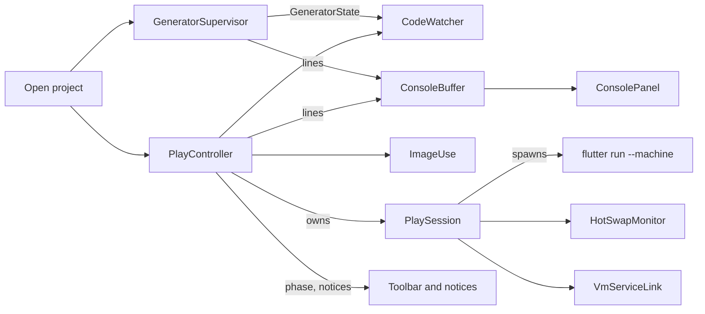

# Pyro — Architecture

How Pyro is built and why. This document starts from the v0.0 de-risking spikes
([`project-plan.md`](project-plan.md) §14) and grows with the code. The plan describes the
intended design; this file records what was verified, what had to change, and what depends on
behavior we don't control.

Status: **v0.0 done.** All three spikes ran; their findings are below.

---

## Spike #1 — Play, Hot-swap and Attach

**Question:** can Pyro own the running game (`flutter run --machine`), Hot-swap saved
scenes into it, and still let the developer attach an IDE for breakpoints and code hot reload?
This was the deciding test for [ADR 0001](adr/0001-studio-runs-the-game-ide-attaches.md).

**Answer:** yes, with two workarounds for how flutter_tools handles a second client
([*Q74*](decisions.md)). The spike also passed `--disable-service-auth-codes` for a stable attach
URL (*Q75*); Pyro doesn't, and hands each run's authenticated URI to the IDE instead (*Q81*).

Code and step-by-step instructions: [`spikes/01_play_hotswap/`](../spikes/01_play_hotswap/README.md).
A Flame game with a minimal content-hashed `PyroScene`, and a Dart driver that plays the
Pyro's part: it spawns `flutter run --machine`, edits files and reloads through the daemon.

Tested with Flutter 3.44.2, Flame 1.38.2, macOS 26.2, 2026-10-16.

### Results

| Check | macOS desktop | iOS simulator | Android emulator | Android phone (CPH2737, USB) |
|---|---|---|---|---|
| (a) Scene save → `app.restart` → `onHotReload` rebuilds | ✅ ~58 ms | ✅ ~70 ms | ✅ ~250 ms | ✅ ~156 ms |
| (b) Dart-only reload doesn't rebuild the scene | ✅ | ✅ | ✅ | ✅ |
| (c) IDE attaches via the fixed DDS port | ✅ `flutter attach` | ✅ VS Code | — | ✅ VS Code |
| (c) IDE attaches with auth codes on via the info file (*Q81*) | ✅ VS Code, before or after Play | — | — | — |
| (c) IDE breakpoints hit | ✅ VS Code (info file) | ✅ | — | — |
| (c) IDE hot reload while Pyro is connected | ✅ | ✅ | — | ✅ |
| (c) Pyro saves still apply after the IDE attaches and reloads | ✅ with both workarounds | ✅ with re-point | — | ✅ with both workarounds |
| (c) Pyro hot restart while the IDE is attached | ✅ with `--project-root` | — | — | ✅ with `--project-root` (❌ without) |

Times are the daemon's hot reload duration for a scene save. iOS physical devices weren't
available; they use the same DevFS path as Android phones (see finding 3), so they're expected to
behave the same. Re-test before the early preview, including Hot-swap on the macOS desktop
target (*Q82*).

### Findings

**1. The planned Hot-swap mechanism works as designed (*Q66, Q67*).** A hot reload through
`flutter run`'s daemon syncs changed asset files to the device and evicts them from `rootBundle`
before `reassemble`. Flame then calls `onHotReload()` on mounted components, so
`PyroScene` can re-read its file with a plain `rootBundle.loadString` and compare hashes. No
custom service extension is needed. A Dart-only reload re-reads the same bytes and leaves the
scene alone.

**2. Each flutter_tools client has its own DevFS; that breaks Hot-swap with an IDE attached.**
`flutter run` and `flutter attach` (which IDEs use) each sync files into a DevFS: a folder on the
device, named after the project folder (`basename(projectRootPath)`), plus an asset folder at
`<DevFS>/build/flutter_assets`. Two consequences:

- **Name clash.** When the IDE attaches, it finds the name taken, deletes Pyro's DevFS and
  creates its own (`DevFS: Creating failed. Destroying and trying again`). The engine is still
  pointed at the deleted folder, so the next read falls back to the original scene in the app
  bundle.
- **Asset shadowing.** Each client calls `_flutter.setAssetBundlePath` only once, on its first
  reload that syncs an asset. After the IDE's first such reload, the engine serves scenes from the
  IDE's copy, which only changes when the IDE reloads. Pyro saves are then ignored, and the
  scene jumps to the latest version on the IDE's next reload.

**3. On physical devices the name clash is permanent.** Desktop and simulators use a local DevFS
writer that writes straight to the folder path, so Pyro's next sync recreates it. Physical
Android and iOS devices write through the VM service *by DevFS name*, which now belongs to the
IDE, so Pyro's folder never comes back. Its hot restart and reloads still use its old
DevFS URI, and restart fails:

```
E/flutter: [ERROR:flutter/runtime/dart_isolate.cc(146)] Could not prepare isolate.
hot restart failed to complete: _flutter.runInView: (-32000) Could not run configuration in engine.
```

**4. Workarounds adopted (*Q74*).**

- **Distinct DevFS name.** `flutter run` has a hidden `--project-root` option. Pyro passes a
  symlink to the project with a different folder name, so its DevFS no longer clashes with the
  IDE's:

  ```
  <app support>/run/<project-id>/<name>-pyro  →  <user's project>
  flutter run --machine -d <device> --project-root <that link>
              (working directory: the real project)
  ```

- **Re-point before every reload.** Before each `app.restart`, Pyro calls
  `_flutter.setAssetBundlePath` on the VM service (`viewId` from `_flutter.listViews`,
  `assetDirectory` = `<DevFS base URI from app.debugPort>/build/flutter_assets`), taking the engine
  back from the IDE's copy. The engine rejects it when the folder doesn't exist yet (before the
  Pyro's first asset sync). Pyro then reloads anyway (which creates the folder),
  re-points, evicts the saved scene files with `ext.flutter.evict`, and reloads once more.

With both in place, every save rebuilt the scene and every no-op reload left it alone, with the
IDE reloading and hot-restarting in between (macOS with `flutter attach`; Android phone with
VS Code). The fallback reload ran only on the first save after launch.

How the engine handles the re-point
(`engine/src/flutter/shell/common/shell.cc`, `OnServiceProtocolSetAssetBundlePath`): it opens
the folder as a new `DirectoryAssetBundle` and puts it first, then keeps only old resolvers that
are valid after an asset-manager change, which DevFS folders aren't. So the last caller wins
outright; there's no fallback to the other client's copy. A folder that can't be opened fails
with `Could not update asset directory.` and changes nothing.

**5. Without `--disable-service-auth-codes`, the attach URL changes every run** (for example
`ws://127.0.0.1:8282/EMWbRKFTAe4=/ws`, then `/rY9Oy8-nQ1I=/ws`), which breaks a saved
`launch.json`. With it and a fixed `--dds-port`, `app.debugPort` reports `ws://127.0.0.1:<port>/ws`
every time (*Q75*).

*Q81 reverses this:* Pyro keeps auth codes on and doesn't need a stable URL. It writes
each run's URI to `.dart_tool/pyro/vm_service.json`, which a VS Code attach entry
reads through the debug adapter's `vmServiceInfoFile` argument (flutter_tools 3.44.2,
`flutter_adapter.dart` `attachImpl`: it waits for the file and reads its `uri` field).
flutter_tools itself marks `--disable-service-auth-codes` deprecated and "not recommended", and
on a wirelessly connected iOS device the VM service listens on all interfaces
(`--vm-service-host=0.0.0.0`), so disabling auth there exposes the game to the network.
flutter's own `--vmservice-out-file` isn't usable for this: it writes the bare URI, not the
JSON the adapter expects.

Tried on 2026-10-17 (macOS desktop, Flutter 3.44.2, Dart-Code 3.144.0), with the spike driver
in its new default (auth codes on, no fixed DDS port, info file written on `app.debugPort`,
owner-only, deleted on stop). A scripted DAP client on `flutter debug-adapter`, the adapter
Dart-Code runs for Flutter, attached through the info file in all three orders: game already
running; adapter started first with no file; adapter started first with no
`.dart_tool/pyro/` folder at all. Started first, it connected ~0.3 s after the file
appeared. A hot reload through the adapter worked with the driver still connected, and the
driver's (a)+(b) checks pass with auth codes on. Then from the VS Code UI, with the "info file"
entry in `launch.json`: VS Code attached without asking for a URI, both with the game already
running and when the entry was started before the driver. Breakpoints hit and IDE hot reload
worked, with no errors. Two details for the Attach guide:

- The adapter runs `flutter attach --debug-uri <uri>`, which still picks a device. With more
  than one connected and no `-d` it exits with "More than one device connected". VS Code adds
  the device selected in its status bar, so the developer must select the game's device there.
- The IDE's Debug Console prints the full URI ("Connecting to VM Service at …"). That log is the
  IDE's, not Pyro's, so it doesn't break "the URI stays out of Pyro's logs".

**6. VS Code shows a stale "paused" after any hot restart while both are connected.** The
nonsense top frames (`List.add`, `int.&`) come from sampling a running isolate. A debug adapter
sets `pause_isolates_on_start` and asks DDS for `requirePermissionToResume(onPauseStart)`, so a
hot restart's new isolate (`IsolateExit` → `IsolateStart` → `PauseStart`) waits for the IDE.
VS Code resumes it and the game runs, but its UI keeps the paused state. A client that never
resumes would leave the game stuck at startup. Without such a client, Pyro's restart emits
no pause events at all. Cosmetic for VS Code; the Attach guide should say to press Continue.
Worth checking against the Dart-Code issue tracker.

**7. Smaller findings for Pyro.**

- **Console:** on desktop targets, the game's `print` output arrives as raw stdout lines rather
  than `app.log` events. The Console must take both.
- **Devices:** `flutter run --machine` emits `device.added` / `device.removed` mid-run for paired
  but unreachable devices (`"isConnected": false`). The device list should ignore them.
- **Two compilers:** each client has its own frontend server, so after an IDE code edit both
  recompile the changed library. That's harmless, but Pyro's next reload reports
  "Reloaded N libraries" even for a scene save.
- **Testing pitfall:** a save that writes the bytes already on disk doesn't change the hash, so
  nothing rebuilds. That's correct, but it looks exactly like a broken Hot-swap; the spike driver
  makes every test edit unique.

### What this depends on

| Dependency | Kind | If it changes |
|---|---|---|
| `flutter run --project-root` names the DevFS after its basename | Hidden flutter_tools option | Re-point still fixes shadowing on desktop/simulators; on physical devices fall back to "Pyro stops reloading while an IDE is attached" |
| `_flutter.setAssetBundlePath` | Private engine service extension (used by flutter_tools itself) | Fall back as above |
| `ext.flutter.evict` | Framework debug service extension | Same fallback |
| Daemon `app.restart` syncs + evicts changed assets before `reassemble` | flutter_tools behavior | Core Hot-swap breaks; would need the Live bridge (v0.4) |
| Flame calls `onHotReload` from `GameWidget.reassemble` | Flame ≥ 1.36 API | Runtime floor in §12 |
| Debug adapter `vmServiceInfoFile` attach argument (JSON with `uri`) | Documented launch.json argument of the Dart/Flutter debug adapters | Attach still works by pasting the copied URI ("Flutter: Attach to Process"); drop the generated attach config |

Pyro re-checks these on every Flutter stable release with the manual end-to-end test
(`project-plan.md` §13). Running the spike driver against the new SDK is the quickest check:
`--ci` for (a)+(b), and the VS Code steps in the spike README for (c).

### Open items

- Physical iOS device, and Android Studio as the attaching IDE: not yet tested.
- Watching for the info file when `.dart_tool/pyro/` doesn't exist yet worked on macOS.
  Linux and Windows are untested; Pyro keeps the folder (deletes only the file) and can
  create it when it writes the attach config.
- On Windows (v0.3), the run link needs a directory junction or Developer Mode symlinks. ◇
  proposed
- First save after launch costs an extra reload. Pyro could avoid it by re-pointing only
  after it has synced an asset once. ◇ proposed

---

## Spike #2 — Generator shape and latency

**Question:** can one source_gen `$lib$` aggregator write both the runtime Registry and the
Manifest into `lib/` (*Q38, Q68*), fast enough in `build_runner watch` for Pyro's edit
loop, and can Pyro tell whether a `build_runner` is already running (*Q48*)?

**Answer:** yes. Every save landed in **~0.9–1.0 s** on 300- and 1000-file Flame projects.
The one exception is the first save after a watcher starts (~2.8 s). The lock probe is reliable
and harmless. Two plan details need changing: **`--only-check` isn't available to Flutter 3.44
projects** (Flutter's `meta` pin caps build_runner at 2.15.1), and Pyro's watcher policy
must handle `build_runner build` and `stop`, not just a second `watch`.

Code and step-by-step instructions: [`spikes/02_generator/`](../spikes/02_generator/README.md).
Stand-in annotation and generator packages, a small Flame game with its committed outputs, a
synthetic-project generator, a watch latency harness and a lock probe with a Pyro-policy
simulator.

Tested with Flutter 3.44.2 / Dart 3.12.2, build_runner 2.15.1 (Flutter projects) and 2.17.1
(pure-Dart projects), Flame 1.38.2, flame_behaviors 1.4.0, macOS 26.2 on an Apple M4,
2026-10-16.

### Results

| Check | Result |
|---|---|
| One `$lib$` builder writes `lib/pyro.g.dart` **and** `lib/pyro.manifest.json` | ✅ |
| Registry compiles; factories and setters work; Registry and Manifest list the same Type IDs | ✅ |
| Watch updates both files ≤ ~3 s, 300 files / 42 annotated | ✅ median 0.9 s; first save after start 2.8 s |
| Same, 1000 files / 142 annotated | ✅ median 0.9–1.0 s; first save 2.8–2.9 s |
| Unannotated edits skipped via `triggers` | ✅ but only 0.05–0.2 s saved (finding 3) |
| Lock probe detects a running `build_runner` without disturbing it | ✅ ~1–4 ms |
| Pyro follows another process taking over | ✅ with the policy change in finding 5 |
| `build --only-check` in CI | ✅ on 2.17.1 · ❌ on Flutter 3.44.2 (finding 1) |
| Outputs byte-identical across clean rebuilds | ✅ |
| build_runner ≥ 2.14 lock (Q48) | ✅ identical on 2.15.1 and 2.17.1 |

Watch latency, Flutter + Flame, 300 files, triggers on (median of 5, from the moment the save's
write returns until build_runner reports the build done):

| Save | Manifest | Registry | Done |
|---|---|---|---|
| First save after watch start | 2.8 s | unchanged | 2.8 s |
| Annotated: tooltip edit | 0.95 s | unchanged | 0.95 s |
| Annotated: add an `@Editable` field | 0.92 s | 0.92 s | 0.92 s |
| Annotated: method body | unchanged | unchanged | 0.89 s |
| Unannotated leaf file | unchanged | unchanged | 0.43 s |
| Unannotated file every annotated file imports | unchanged | unchanged | 0.90 s |
| New annotated file | 0.90 s | 0.90 s | 0.90 s |

Other configurations (1000 files, triggers off, pure Dart) are in the spike README.

### Findings

**1. Flutter 3.44 caps build_runner at 2.15.1, so no `--only-check` there.** Flutter 3.44.2
pins `meta: 1.18.0`; `analyzer` ≥ 13.1.0 needs `meta ^1.18.3`; build_runner ≥ 2.15.2 needs
`analyzer` ≥ 13.3.0. In a Flutter project, `build_runner: ^2.16.0` doesn't resolve, and an open
constraint picks 2.15.1 (with analyzer 13.0, build 4.0, source_gen 4.2). Flutter 3.47.0 relaxed
the pin to `meta: ^1.18.3` (read from the 3.47.x tags, not tested). Two consequences:

- The generator must accept a **wide dependency range** (`analyzer >=12 <15`, `build >=4 <6`,
  `source_gen >=4 <5`, `dart_style >=3 <4`) or it won't resolve in the user's project at all.
  The spike's generator builds unchanged at both ends.
- The plan's CI recommendation (*Q68*, §7.3: `--only-check`, build_runner ≥ 2.16) needs
  **Flutter ≥ 3.47**. Below that, CI can run `dart run build_runner build` and then
  `git diff --exit-code lib/pyro.g.dart lib/pyro.manifest.json`. Decided as
  *Q76*; the `git diff` variant wasn't run in the spike

**2. Latency is a fixed cost, not a project-size cost.** Each save pays ~0.4–0.5 s before any
builder runs: build_runner's 250 ms debounce (`commands/watch/watcher.dart`) plus FSEvents. A
pure-Dart project shows only that (0.5 s total, builds of 0.01–0.06 s). With Flutter + Flame,
each changed library the scanner must re-resolve adds ~0.4 s of analyzer resolution, whether
the project has 300 or 1000 files. The first build after a watcher starts takes ~2.4 s of
analyzer warm-up for the Flutter SDK. That is the only save near the 3 s budget, and it comes
right after Pyro starts its watcher (or after a takeover). Cold costs: the first build in a
fresh checkout takes ~14–16 s, ~10 s of which is AOT-compiling the builders; that repeats
whenever the generator's dependencies change.

**3. `triggers` work but aren't what keeps it fast.** `run_only_if_triggered` with
`annotation PyroBehavior` / `annotation PyroComponent` skips unannotated libraries ("259 not
triggered"), saving up to ~0.1 s per save and ~0.1–0.2 s per full build. Resolution of annotated
libraries dominates, and an edit to a file all of them import re-runs the scanner on all of
them either way. Keep triggers (free, and they scale with unannotated code). Annotation triggers
match by name, so re-exported or renamed annotations need their own trigger.

**4. The `$lib$` shape works as planned (*Q68*).** A per-library scanner writes a JSON fragment
to the build cache only for libraries with annotated classes. A `$lib$` aggregator
(`required_inputs: [".studio.json"]`, `findAssets(Glob('lib/**.studio.json'))`,
`build_to: source`) writes both files. Properties Pyro relies on:

- **Outputs are written only when their content changes** (build_runner ≥ 2.14 doesn't
  rewrite identical outputs). Body edits and unannotated edits touch neither file; a tooltip
  edit changes only the Manifest. Pyro can re-parse on every Manifest file event.
- **Errors reach the Manifest even when the build fails.** The aggregator writes both outputs,
  then `log.severe`s: the build fails (exit 1), the Manifest's `errors` is filled in, the watch
  keeps running and recovers on the next good save, and a no-change rebuild reports the error
  again. Types with errors are left out of both files. With duplicate Type IDs, *every* class
  sharing the ID is dropped (an earlier version kept the first by path and the Registry built
  the wrong class).
- **Deterministic:** clean rebuilds are byte-identical; `--only-check` (2.17.1) passes on a
  fresh clone with no build cache and fails, listing the file, on a stale, hand-edited or
  missing output. It prints no diff.
- §7.3 calls this "the pattern source_gen's own combining builder uses". Not quite:
  `CombiningBuilder` combines fragments **per library** into `<file>.g.dart`; the `$lib$` scope
  is ours.

**5. The lock probe works; the watcher policy needs one more rule.** build_runner ≥ 2.14 holds
an exclusive lock on `.dart_tool/build/lock/build_runner.lock` in the `dart run build_runner`
process (not its AOT builder child) for the whole run of **any** command, including a one-off
`build`. The probe opens it with `FileMode.append` (no truncate or create), tries
`lockSync(FileLock.exclusive)` and unlocks at once. It takes ~1–4 ms, and 50 probes against a
running watch neither stopped it nor wrote `.requested`. `kill -9` of the holder frees the lock.
When another command starts, the running watch finishes its build, prints
`Exiting as requested by another build_runner process.` and exits **0**. That is the same for a
second `watch`, a one-off `build` and `build_runner stop`:

| User runs… | After Pyro's watcher exits | Pyro should |
|---|---|---|
| `build_runner watch` | lock held for as long as it runs | show "External build_runner"; when the lock is released, start its own watcher again |
| `build_runner build` | lock held for a few seconds, then free; nobody watching | same: external, then restart |
| `build_runner stop` | lock already free at the re-probe | **not** restart: show "Generator stopped" with a Start button |

§9.2 currently covers only the first row. The rule, verified with the spike's `--studio`
simulator: **after a takeover exit, re-probe; held → external, then restart on release; free →
stopped.** Decided as *Q77* (§9.2). Also, `--only-check` and any other build_runner command run locally take
the lock and stop Pyro's watcher.

**6. Smaller findings for the generator.**

- **Imports:** importing each field type's declaring library gives
  `package:flame/src/sprite_animation.dart` and `package:vector_math/vector_math.dart`, a
  package the game doesn't depend on directly. It compiles, but the real generator should import
  types through the public libraries the user's file imports.
- **Defaults:** literals and enum constants are evaluated; `const Color(0xFFFFFFFF)` and
  `Vector2(1, 0)` keep their source text in `defaultSource`. The analyzer could evaluate const
  initializers if the inspector needs real values.
- **`supertypes`** from `allSupertypes` includes every Flame interface (14 entries for a
  `PositionedEntity`). Pyro likely needs the class chain plus `EntityMixin`; trim it in
  the generator.
- **Registry setters** only cast (`(v as num).toDouble()`, `values.byName`, `v as Vector2`);
  JSON → `Vector2` / `Color` / asset / entity-reference conversion stays in the Runtime.

### What this depends on

| Dependency | Kind | If it changes |
|---|---|---|
| Lock file path and `FileLock.exclusive` held for the whole command | build_runner implementation detail (`bootstrap/build_process_lock.dart`), not documented API | Probe reports `none`/`free` wrongly; Pyro would start a watcher that waits on the lock (`Waiting for already-running build_runner.`), so detect that line too |
| Exit message `Exiting as requested by another build_runner process.` | Log text | Fall back to "exit code 0 while Pyro didn't stop it" |
| Unchanged outputs aren't rewritten | build_runner ≥ 2.14 behavior | Pyro would need to compare Manifest content before re-parsing |
| `run_only_if_triggered` / `triggers` | build_config ≥ 1.2 feature | Latency barely changes (finding 3) |
| Outputs written before `log.severe` stay on disk | build_runner behavior | Errors only reach Pyro via the Console |
| Flutter's `meta` pin | Flutter SDK | Decides whether `--only-check` is available (finding 1) |

### Open items

- Flutter ≥ 3.47 with build_runner 2.17: re-run the latency matrix and `--only-check` in a real
  Flutter project.
- Pub workspaces: the probe also takes a shared lock on `build_runner.workspace.lock` at the
  workspace root; not exercised.
- Windows (v0.3): `lockSync` uses `LockFileEx` there; probe behavior untested.
- Could Pyro warm the analyzer right after starting its watcher, to move the 2.4 s
  first-build cost off the user's first save? ◇ proposed

---

## Spike #3 — Disk rendering

**Question:** can Pyro, a Flutter macOS app with its own bundled Flame, render sprites,
animations and Tiled maps loaded from the user's project folder on disk rather than from its
own asset bundle (*Q31, Q10*), and pick up edits to those files without restarting?

**Answer:** yes. A ~40-line `AssetBundle` that reads files under the project root is all Flame
and flame_tiled need; every loader takes a bundle and an `Images` cache as parameters. Edits
reach the screen in **~75–200 ms**, reloading only what used the file. Three things need care:
**flame_tiled resolves tileset images with a heuristic** that breaks for some valid Tiled
layouts (for the game too), **`Images.clear` disposes images that may still be on screen**, and
flame_tiled keeps a **process-wide atlas cache** that must be cleared before rebuilding a map.

Code and step-by-step instructions: [`spikes/03_disk_render/`](../spikes/03_disk_render/README.md).
An unsandboxed Flutter macOS app standing in for Pyro's viewport, a generator for a tiny
hand-made project (PNGs, `.tmx`, `.tsx`), an edit script and a latency summarizer.

Tested with Flutter 3.44.2, Flame 1.38.2, flame_tiled 3.1.2 (tiled 0.11.1), macOS 26.2 on an
Apple M4, 2026-10-16.

### Results

| Check | Result |
|---|---|
| Sprite, frame animation and Tiled map (external `.tsx` in another folder, embedded tileset with `../` image) rendered in a `GameWidget` from a folder chosen at runtime | ✅ |
| `.tsx` in a subfolder, image in a subfolder of that (`sets/edge.tsx` → `img/edge.png`) | ✅ with our loader · ❌ `TiledComponent.load` (finding 2) |
| Edit in place / temp + rename / delete / re-create a file → only what read it reloads | ✅ write → frame median 76–176 ms, max 199 ms |
| Unrelated file changes | ✅ ignored |
| Missing file → inline error; re-created → recovers | ✅ |
| Release build, unsandboxed | ✅ same, write → frame 64–95 ms |
| Sandboxed build | ❌ `Operation not permitted` (expected, §12) |
| One shared `Images` cache, `Images.clear` on change | ⚠️ a race: blank viewport until the swap (finding 3) |
| Rebuild a map without `TiledAtlas.clearCache()` | ❌ stale pixels, lost dependencies (finding 4) |

Initial load of the sample (4 slots, 9 files): ~135 ms debug, ~115 ms release. Reload time is
FSEvents delivery (10–115 ms, bimodal around 12 and 112 ms), a 30 ms debounce, 2–25 ms of
building and two frames.

### Findings

**1. Pointing Flame at disk is a small `AssetBundle` (*Q31*).** `DiskAssetBundle` overrides
`load`, `loadString` and `loadStructuredData` and reads the file on every call. `Images(bundle:,
prefix: '')`, `TiledComponent.load(bundle:, images:, prefix:)`,
`RenderableTiledMap.fromTiledMap(images:)` and `FlameTsxProvider.parse(key, bundle, prefix)` all
take it; no globals (`Flame.bundle`, `Flame.images`) change, so each open project can have its
own. Keys are paths relative to the project root, the same strings the game declares in
`pubspec.yaml`, so one scene reference loads from disk in Pyro and from `rootBundle` in
the game. The planned `AssetSource` is therefore little more than "which `AssetBundle`, plus
who owns the image cache". Doesn't carry over: `Images.loadAllImages` / `loadAllFromPattern`
need an `AssetManifest`, which a folder doesn't have; Pyro lists files itself.

**2. flame_tiled's tileset image paths are a heuristic, wrong for some valid maps.** `.tsx`
files resolve relative to the map, like Tiled. Tileset images are loaded relative to the
*map's* folder, and `TiledAtlas.fromTiledMap` prefixes the `.tsx` folder only when the image
path and the `.tsx` path have a different number of segments. So `../tilesets/terrain.tsx` +
`terrain.png` works, but `sets/edge.tsx` + `img/edge.png` loads `assets/maps/img/edge.png`
instead of `assets/maps/sets/img/edge.png`. This isn't a disk problem: a game calling
`TiledComponent.load` on its bundle fails the same way. The spike's loader (~60 lines, public
API only) parses the map with `TiledMap.fromString` and its own `TsxProvider`, rewrites every
tileset, per-tile and image-layer source to a root-relative path resolved against the file that
references it, clears `tileset.source` so flame_tiled doesn't re-join, and calls
`RenderableTiledMap.fromTiledMap`. Consequence: if Pyro renders maps with that loader and
the game uses stock `TiledComponent.load`, a map can look right in Pyro and fail in the
game. The `tiledMap` Node kind (v0.2) should load through **one shared loader in
`pyro_runtime`**, used with the disk bundle in Pyro and `rootBundle` in the game.
Adopted (*Q78*). Reported as flame-engine/flame#4117.

**3. `Images.clear` disposes while the old component still draws.** `Images` can't forget an
entry without `Image.dispose()`. Clearing a changed file's key and then rebuilding leaves the
old component drawing a disposed image until the swap: `Canvas.drawImageRect` fails
`assert(!image.debugDisposed)` and the frame stops at that component, so everything drawn
after it disappears. At normal speed the rebuild fits in one frame and nothing showed; with
reads slowed to 300 ms the viewport was blank for the whole window (18 failed asserts). The
spike's fix: build each reload into a **fresh `Images`**, swap synchronously
(`old.removeFromParent(); world.add(new)`), and dispose the old cache after `await old.removed`.
That gives up sharing decoded images between Nodes. Pyro's own cache should keep old
images alive until nothing draws them (versioned entries, or `Image.clone()` handles that
holders dispose). Adopted (*Q79*). Also, a failed `Images.load` stays cached (from the source) and
logs an extra unhandled async error.

**4. flame_tiled's atlas cache is static and keyed by file names.** `TiledAtlas.atlasMap` is a
process-wide map keyed by the tileset image source strings, regardless of bundle or `Images`.
Rebuilding a map without `TiledAtlas.clearCache()` keeps the old pixels, and since the atlas
hit skips `Images.load`, the map's image files drop out of dependency tracking and later edits
to them are ignored. From the code, maps or projects whose tilesets use the same image source
strings would also share an entry. The spike clears it before every map build; Pyro
should drop only the affected entries.

**5. Reloading only what changed.** Each Node build runs in a `Zone` holding a set; the bundle
and an `Images` subclass add the absolute path behind every load (cache hits included). A file
event rebuilds the Nodes whose set contains it. Keeping the set of a *failed* build means a
re-created missing file triggers the rebuild. Watching uses `Directory.watch(recursive: true)`.
FSEvents reports real paths (`/private/tmp/…` for `/tmp/…`), so the root must go through
`resolveSymbolicLinksSync()` first. A temp + rename save produces events for both files; a
30 ms debounce turns them into one reload.

**6. Pyro must stay unsandboxed (§12).** Sandboxed, `File.existsSync()` still says true
but every read fails with `Operation not permitted`; it would need security-scoped bookmarks
per project folder.

**7. Versions (*Q18*).** Disk rendering reads files, not user code, so it doesn't tie the
Pyro to the user's Flame version. Pyro does bundle a matched pair: flame_tiled 3.1.2
requires `flame ^1.38.0` and Flutter ≥ 3.41, and pins `tiled ^0.11` → `xml ^6`. What has to
match is *behavior*: Pyro must resolve and render a map the way the game's Runtime will.
Flame's main branch (unreleased, 2.0 train) already changes exactly these APIs:
flame-engine/flame#4015 removes `prefix` from `Images`, `AssetsCache` and flame_tiled (full
bundle paths as keys; tileset images resolve against a new `imagesDirectory`), and
flame-engine/flame#4073 moves to tiled 0.12 (`TsxProvider` → `ParserProvider`, xml 7). Both
break the spike's loader. §12's "latest stable Flame minor" policy needs a line for the 2.0
major: the shared tiled loader (finding 2) and the `AssetSource` are where it lands. Adopted
(*Q80*): Runtime and Pyro move to Flame 2.0 together; 1.x gets fixes only.

### What this depends on

| Dependency | Kind | If it changes |
|---|---|---|
| Flame loaders take an `AssetBundle` / `Images` parameter | Public Flame and flame_tiled API | Fall back to `Flame.bundle = disk` (global, one project at a time) |
| `RenderableTiledMap.fromTiledMap` and mutable `Tileset.source` / `.image` | Public API (flame_tiled, tiled) | Our loader stops working; changes with tiled 0.12 (finding 7) |
| `TiledAtlas.clearCache()` / `atlasMap` | Public static, `atlasMap` `@visibleForTesting` | Stale map images after edits |
| `Images.clear` disposes immediately | Flame behavior | If it stops disposing, a shared cache becomes safe |
| FSEvents via `Directory.watch` | dart:io on macOS | Windows/Linux (v0.3) use other backends; re-measure |

### Open items

- Follow flame-engine/flame#4117 (the `.tsx` image path heuristic, finding 2), and re-test
  `edge.tmx` on the tiled 0.12 / Flame 2.0 release.
- Not in the sample: object layers, image layers, templates (`.tx`), infinite maps,
  collection-of-images tilesets. The loader rebases image layers and per-tile images, untested.
- The **Browse…** folder panel (`file_selector`) wasn't exercised; the folder came from an
  environment variable read at runtime.
- Windows and Linux file watching (v0.3).

---

## Scene format — `schemaVersion` 1

**Question:** can the Scene file be read and written fast enough that opening, saving and
Hot-swap feel instant (SC-006 of [`specs/001-scene-format/`](../specs/001-scene-format/spec.md):
median under 100 ms each to read and to write a 1,000-Node Scene)?

**Answer:** yes, with a wide margin. The strict reader and canonical writer in
`pyro_runtime/lib/src/scene/` (*Q92*) were timed with `benchmark/scene_codec_benchmark.dart`: a
1,001-Node Scene (250 entities with one Behavior each, a sprite and two hitboxes), 365.5 KB,
10 warm-up runs, then 50 timed runs.

| Build | Decode median (p95) | Encode median (p95) |
|---|---|---|
| JIT (`dart run`) | 2.51 ms (3.62 ms) | 4.47 ms (6.28 ms) |
| AOT (`dart compile exe`) | 2.30 ms (2.95 ms) | 4.38 ms (4.69 ms) |

Measured 2026-10-18 on the **reference machine for SC-006**: Apple M4, 16 GB, macOS 26.2, Dart
3.12 (Flutter 3.44.2). Plain `dart run` works for the benchmark because the format code is pure
Dart (research R5), so no `flutter test` fallback was needed.

**Findings**

1. **The strict reader costs little.** Refusing duplicate keys and reporting line and column
   needed a hand-written parser (`jsonDecode` keeps the last duplicate silently). At ~2.3 ms for
   365 KB it is about as fast as `jsonDecode` was in the planning probe (~1.7 ms for 540 KB, JIT),
   so Pyro can decode on the UI isolate for typical Scenes; `Isolate.run` stays available for
   very large ones.
2. **Writing costs about twice as much as reading**, mostly in sorting keys and escaping
   strings. Still ~20× inside the budget.
3. **One gap found in the planned repair rules.** "Attach the smallest remaining ID" doesn't
   break a cycle when that ID only hangs off the cycle. The repair instead follows listing
   parents up from it until a Node repeats and attaches the smallest ID on that cycle
   (`tree_repair.dart`; fixture `damaged/cycle_with_tail`).

## Document model

**Question:** do snapshot undo and the Document's file handling keep editing instant and memory
modest on a 1,000-Node Scene ([`specs/002-document-model/`](../specs/002-document-model/spec.md):
SC-005, a one-Node transaction, undo or redo under 1 ms; SC-006, a 200-step history under
2 MB), and does opening or saving keep the UI isolate free?

**Answer:** yes. Measured with `apps/editor/benchmark/document_benchmark_test.dart`
(`flutter test --enable-vmservice`, so JIT numbers, an upper bound for the release build) on a
1,000-Node Scene of entities, each with a sprite and a rectangle hitbox.

| What | Result | Budget |
|---|---|---|
| One-Node transaction (`replaceNode`), median (p95) | 8 µs (43 µs) | < 1 ms |
| Undo, redo, median | < 1 µs | < 1 ms |
| Open, total / longest pause of the calling isolate | 42 ms / 3 ms | pause < 16 ms |
| Save, total / longest pause of the calling isolate | 24 ms / 4 ms | pause < 16 ms |
| 200-step history, beyond the Scene and the opening state | 909 KB | < 2 MB |

Memory comes from a heap snapshot (`HeapSnapshotGraph` through the VM service): the bytes the
history reaches that neither the Scene (525 KB) nor its opening state (142 KB more) reaches.
Measured 2026-10-19 on the reference machine (Apple M4, macOS 26.2, Flutter 3.44.2).

**Findings**

1. **Snapshot undo can't stay under 10% of the Scene, which SC-006 first asked for.** Each
   one-Node step keeps its new Node (about 0.6 KB here), so 200 steps on 1,000 Nodes cost about
   20% before any map overhead; with `fast_immutable_collections`' automatic flushing turned
   off the history was 130 KB (25%). With the default flushing (a full flat copy of the map
   every 50 counted operations, reads included, which keeps lookups O(1)) it is 909 KB. SC-006
   is now "under 2 MB" (spec clarification, 2026-10-19); diff-based undo would hold far less
   and is a possible later enhancement (*Q99*).
2. **`Isolate.run` costs latency, not frames.** Decoding a 1,000-Node Scene takes about 2.3 ms
   (Scene format section above), but open takes 42 ms in total because of the isolate's start
   and the transfer back. The calling isolate pauses for at most 3–4 ms, so the editor keeps
   drawing. For typical Scenes, decoding in place would also fit in a frame; the injected
   `Offload` makes either choice a one-line change.
3. **In this workspace, spike #4's code-generator versions don't resolve on Flutter 3.44.2.**
   `pyro_annotations` and `pyro_generator` depend on `test`, and the `test` versions that match
   `flutter_test`'s pinned `test_api` 0.7.11 cap analyzer below 13 (the lock holds 12.1.0).
   freezed 4.0.0-dev.3 and riverpod_generator 4.0.9 need analyzer ≥ 13; the working set is
   freezed 3.2.6-dev.1, riverpod_generator 4.0.4, flutter_riverpod 3.3.2 and build_runner
   2.15.1 (spec 002, research R1). Flutter 3.47.x (Dart 3.13) would allow stable freezed 4.x.
4. **freezed needs `map`/`when` off for a class whose only factory is private**, or the generated
   code fails to compile (`SceneDocument`, which has no public constructor so that only the
   tree-safe edits make new states).

## Generator

**Question:** does the Generator ([`specs/003-generator/`](../specs/003-generator/spec.md))
keep spike #2's shape and speed with the real rules, every v1 Field type and the error
reporting, and does it resolve across its wide dependency ranges?

**Answer:** yes, with three findings below. The per-library scan plus `$lib$` aggregator of
spike #2 is kept; all 25 diagnostic codes have a golden case (26 since spec 004 added
`unreachableParentType`); the fixture game
(`packages/pyro_generator/fixture_game`) builds against real Flame, its Registry analyzes clean
and creates every type, and clean rebuilds are byte-identical.

| What | Result |
|---|---|
| Tests at the workspace's versions (analyzer 12.1.0, build 4.0.7, source_gen 4.2.4, dart_style 3.1.8) | ✅ 116 pass |
| Same tests at the top of the ranges (analyzer 14.5.0, build 5.0.0, source_gen 4.3.1, dart_style 3.1.14) | ✅ 116 pass, goldens byte-identical |
| Real Flutter project outside the workspace (analyzer 13.0.0, build_runner 2.15.1) | ✅ builds 42 types, no errors |
| Fixture game, clean cache, built twice | ✅ byte-identical outputs |

Watch latency, 300 files / 42 annotated, Flutter 3.44.2, build_runner 2.15.1, median of 5, with
spike #2's harness (`gen_project.dart --pyro`, `measure.dart`). **Linux early signal**, not the
reference Mac (a 4-core Intel Xeon @ 2.1 GHz cloud container, 2026-10-20); SC-004 is still to
be measured on the M4 (task T045):

| Save | Manifest | Registry | Done |
|---|---|---|---|
| First save after watch start | 6.7 s | unchanged | 6.7 s |
| Annotated: tooltip edit | 1.56 s | unchanged | 1.58 s |
| Annotated: add an `@Editable` field | 1.60 s | 1.61 s | 1.62 s |
| Annotated: method body | unchanged | unchanged | 1.70 s |
| Unannotated leaf file | unchanged | unchanged | 0.45 s |
| Unannotated file every annotated file imports | unchanged | unchanged | 1.69 s |
| New annotated file | 1.73 s | 1.73 s | 1.75 s |

Every annotated save lands well under the 3 s budget on this slower machine; the first save
after the watcher starts pays the analyzer's warm-up (2.8 s on the M4 in spike #2), as before.

**Findings**

1. **`vector_math` declares `Vector2` in a part file.** The class's library is
   `package:vector_math/vector_math.dart`, so matching the part's path
   (`src/vector_math/vector2.dart`, research R3's first plan) matched nothing and every `Vector2`
   field was "unsupported". The checker matches the library's URL; `vector_math_64`'s `Vector2`
   (also a part) is told apart by its library.
2. **build_runner doesn't restore a hand-edited output while its cache is warm.** With
   unchanged inputs, `build_runner build` wrote nothing after `lib/pyro.g.dart` was edited by
   hand. CI is unaffected (a fresh checkout has no cache, so the regenerate-and-diff check of
   §7.3 sees the edit), but locally a stale output needs `rm -rf .dart_tool/build` or an input
   change.
3. **The packages need `dependency_overrides` when used by path or git.** `pyro_generator`
   depends on `pyro_annotations` by version, as `pyro_runtime` does, so a project using them
   from the repository before pub.dev (Phase 5's README recipe) must override all three.
4. **Included `analyzer: exclude` lists merge.** The root options' `**/*.g.dart` exclusion
   can't be undone by an including file, so CI analyzes the fixture's `lib/pyro.g.dart` by
   naming it, which analyzes a file even when excluded (verified in a scratch project).
5. **Enum values named `int`, `double` and `bool` shadow the core types inside the enum body.**
   `FieldType` keeps those names (they match the Manifest); code that needs the core types sits
   outside the enum.

## Runtime

**Question:** does the Runtime ([`specs/004-runtime/`](../specs/004-runtime/spec.md)) load every
Node kind and Field type into a Flame game through the generated Registry, Hot-swap only changed
Scenes, and stay within SC-004's budgets?

**Answer:** yes on everything the container could check, and the manual Hot-swap run in a macOS
app passed on the reference Mac (2026-10-22, spec 005's run; "Vertical slice / On the reference
Mac" below). The reference-Mac timings and the pause limit stay to do (task T043). Before
building, a test pinned every Flame fact the plan had only read from source
(`test/loader/flame_assumptions_test.dart`): all held.

| What | Result |
|---|---|
| Runtime tests (`flutter test` in `pyro_runtime`) | ✅ 331 pass |
| Fixture game: a Scene loaded through `rootBundle` with the generated Registry | ✅ |
| Generator goldens with `acceptsParent` | ✅ |
| Release build free of Hot-swap code (SC-006) | ✅ 0 matches (spec 005, quickstart §5.9, 2026-10-22) |

Timings on the 1,000-Node benchmark Scene (`benchmark/load_benchmark_test.dart`), median (p95) of
20 runs, `flutter test` (JIT, asserts on), image decoding excluded. **Linux early signal**, not
the reference Mac (a 4-core Intel Xeon @ 2.1 GHz cloud container, Flutter 3.44.2, 2026-10-20):

| | median ms | p95 ms | longest pause ms | budget (median) |
|---|---|---|---|---|
| Load | 16 | 22–25 | 26–29 | < 50 |
| Hot-swap check, nothing changed | 0.05 | 0.08 | 0.3 | < 5 |
| Hot-swap rebuild | 32 | 51–65 | 55–66 | < 100 |

The "longest pause" is the longest stretch the isolate ran nothing else, so it couldn't draw a
frame. With an in-memory asset source a load never waits on I/O and shows up whole: decoding the
Scene took 6.7 ms of it here (2.3 ms on the M4, Scene format section above), building 1,000
components the rest. Both pauses are over a 16 ms frame on this machine; whether that needs a
limit, and the builder yielding between passes, is decided from the reference-Mac numbers
(spec Clarifications, T043).

**Findings**

1. **A hitbox needs a positioned ancestor.** Flame throws "A ShapeHitbox needs a PositionComponent
   ancestor" when a hitbox's parent isn't positioned, so a hitbox directly under a Scene's root
   (a plain `Component`) can never work. The Runtime fails the load naming the Node (*Q115*); Pyro's
   hierarchy should not offer that placement.
2. **Flame's `Images` can't forget a failed load cleanly.** `Images.clear` on a failed entry
   disposes it through `future.then`, which raises the original error again as an unhandled one
   (spike #3 finding 3 saw the same). `AssetSource.bundle` therefore keeps its own `Future<Image>`
   cache and drops a failed entry, so a fixed file loads on the next Hot-swap.
3. **`removeAll` only queues the removal.** Until the next game tick a removed component is still
   mounted, and its `mounted` future is already complete. The stale-reference watch attaches its
   listeners only after `removed` completes; otherwise every swap would warn at once.
4. **Re-adding a stale component re-mounts its subtree.** Each Node of it warns once, so adding
   back a stale player that carries a stale child prints two warnings, as specified (once per
   Node per rebuild).


## Vertical slice

**Question:** does the whole contract work end to end with no editor UI
([`specs/005-vertical-slice/`](../specs/005-vertical-slice/spec.md))? The parts are:
- `example/`'s hand-written Scene, run through the real Generator and Runtime;
- the CI contract test;
- Pyro's own `flutter run --machine` client, with a save Hot-swapping the Scene and a Dart-only
  reload leaving it alone.

**Answer:** yes, on Linux and on the reference Mac (below), except for what only a person looking
at the window can confirm (see *Not verified*). Steps 2 and 4 of quickstart §5 passed, so no
change to the default Play target is proposed (*Q82*, SC-010). Results:

| What | Result |
|---|---|
| Play client tests (`flutter test test/process/` in `apps/editor`, transcripts, no device) | ✅ 48 pass |
| `example/` tests: Scene loads with every Override, `Spin` turns, HUD, no-op reload | ✅ |
| Contract checks locally: committed files, golden, every Scene, analysis | ✅ |
| Each deliberate breakage fails at its own check (quickstart §3) | ✅ all five |
| `bin/play.dart` on a project without `macos/`, or with a missing `flutter` | ✅ exits 1, names the path or executable |
| The loop end to end on **Linux** (a throwaway Linux runner and `-d linux`, under Xvfb) | ✅ see below |
| The same on the macOS desktop target, through `bin/play.dart` | ✅ quickstart §5 steps 1–8, see "On the reference Mac" |
| Release build free of Hot-swap code (FR-027) | ✅ 0 matches (the debug kernel has 2) |

The Linux run is an **early signal**, not the reference Mac. It used a 4-core cloud container
with software rendering under Xvfb, Flutter 3.44.2, on 2026-10-22, and
`benchmark/hot_swap_latency.dart`, with the client's device and runner check pointed at Linux
for that run only. Times run from the save to the game's "Scene reloaded" line:

| Check | Result | Limit (*Q119*) |
|---|---|---|
| SC-004 save → Scene reloaded, median of ten | 338 ms | < 500 ms |
| SC-004 worst of ten | 462 ms | < 1000 ms |
| SC-005 rebuilds after ten no-op saves and Dart-only reloads | 0 | 0 |
| SC-006 reloads for ten saves 100 ms apart | 1 | ≤ 2, last content shown |

The daemon's hot reload took 121–263 ms of each save. The rest was the 150 ms quiet period
(*Q122*) and file events. A manual session showed the rest of the loop:
- a save of `"turnsPerSecond": 2` swapped the Scene;
- a save naming an unknown Type ID printed the Runtime's `couldn't Hot-swap` message, naming the
  Scene, the Node and the Type ID, and the game kept running;
- the next valid save swapped again;
- `q` stopped the game with exit code 0.

**Findings**

1. **The game can read its Scene before the daemon says `app.started`.** On Linux the game's
   "Scene loaded" line arrived ~100 ms before `app.started`. A save in that gap reached the game
   too late for its first read, and the client, which then watched only after `app.started`,
   dropped it. The client now watches from the spawn and sends one reload after `app.started`
   for any save made meanwhile (*Q122*). The Runtime ignores that reload if the game already read
   the new file.
2. **Flutter 3.44.2 sends two more address-carrying events**, `app.devTools` and `app.dtd`, after
   `app.debugPort`. The client drops them like `app.debugPort` (*Q121*). Redaction had already
   masked their auth codes before the client knew them.
3. **Tool lines also arrive as raw stdout.** `flutter run --machine` writes its own `pub get` and
   build output as plain lines, not daemon messages, and they can't be told apart from the game's
   stdout. The client labels every raw line `game`; the Console (#11) may want to group the lines
   before `app.started` as the tool's.
4. **`build_runner` keeps a hand-edited output when its inputs are unchanged.** It doesn't rewrite
   `lib/pyro.g.dart` on a warm cache, so a local `git diff` check after an edit can pass while a
   fresh checkout, as in CI, fails it. To reproduce CI locally, delete `.dart_tool/build` first.

### On the reference Mac

Run on 2026-10-22: macOS 26.2, Apple M4, **Flutter 3.44.9** (the quickstart names 3.44.2; same
minor, no difference seen), `-d macos --debug`.

| Quickstart | Result |
|---|---|
| §1, §2 | ✅ 48 client tests; `example/` generates with no diff, analysis clean, tests pass |
| §4 `flutter run -d macos` from a fresh clone | ✅ "Scene loaded" 26 s after the clone's `dart pub get`. **Warm** pub and build caches, so SC-001 (< 5 min) is met but not measured cold |
| §5.1 start through `bin/play.dart` | ✅ `started` in 11.4 s; no line holds an auth code |
| §5.2 save `turnsPerSecond` and the banner | ✅ reload 100 ms, then "Scene reloaded" (a swap) |
| §5.3 `touch` the Scene | ✅ reload 81 ms and no "Scene reloaded" (no swap) |
| §5.4 `codeMarker` to `v2`, `r` | ✅ reload of 3 libraries, no "Scene reloaded" |
| §5.5 invalid JSON, unknown Type ID, `"fast"`, three times each | ✅ nine `couldn't Hot-swap` messages naming the Scene, the Node and the type or field; a valid save then swapped |
| §5.6 `benchmark/hot_swap_latency.dart` | ✅ SC-004 median 321 ms, worst 334 ms; SC-005 0 rebuilds; SC-006 1 reload |
| §5.7 five start and stop cycles (`q` ×3, SIGINT, window close) | ✅ each exits 0 and leaves no `pyro_example` or `flutter run` process |
| §5.8 start errors | ✅ no `macos/`: exit 1 naming the path; syntax error in `lib/main.dart`: exit 1 quoting the compile error |
| §5.9 release build | ✅ 0 matches for `couldn't Hot-swap` in `App.framework/App`; the string is in the Debug build's kernel (2) and `Scene loaded` is in the Release binary (2), so the search works |
| §5.10 transcripts | ✅ replaced with recordings, see `apps/editor/test/fixtures/daemon/README.md` |

**Looked at in the window** (a second run, with screenshots): the ship turns clockwise, the banner
"Hello from Pyro" is white and the HUD reads `time: …s  swaps: 0  code: v1`. A save changed the
banner to "Hello again" and `swaps` to 1 while `time` kept counting. `codeMarker` to `v2` and `r`
changed the HUD to `code: v2` and left `swaps` at 1. The red close button ended the session with
`Lost connection to device.` and exit 0, with nothing left running.

**Not as the quickstart says.** §4 expects the ship's **hitbox** to show. No outline is drawn:
`example/` has no code that paints it, and the Scene's `body` hitbox is only a component. Either
the quickstart should stop expecting it, or the example should turn on debug drawing. The author
decides. The spin speed was judged from two frames (clockwise), not measured against 0.5 and 2
turns a second.

**Findings on the Mac**

1. **`flutter run` prints `Failed to foreground app; open returned 1` on stderr** at start. It is
   harmless and shows as a `stderr:` line.
2. **A compile error in a Dart reload reaches the client on stderr**, and the response is only
   `{"code":1,"message":"DevFS synchronization failed"}`. The CLI shows the stderr lines just
   before `reload failed: DevFS synchronization failed`. The tests now expect that message.
3. **The window close also ends with `app.stop`**, after `Lost connection to device.`. The old
   hand-written crash transcript had no `app.stop`.
4. **A save in an editor arrives as an atomic rename**: the first reload lists
   `assets/scenes/.!NNNNN!level1.scene.json` with the Scene (`sed -i` on macOS). One reload, as
   designed.

## Editor

**Question:** can an author build, save and reopen a scene in Pyro alone, with every value the
editor doesn't understand kept
([`specs/006-editor/`](../specs/006-editor/spec.md))? The parts are:
- the editor window with scene tabs, the save gates and the recovery *Restore* prompt;
- the Type catalog, read from `lib/pyro.manifest.json` as it changes;
- the viewport (reconciler, disk assets, move gizmo), the hierarchy, the inspector and Behaviors.

**Answer:** yes, on the reference Mac, with the gaps listed under *Findings*. Run on 2026-10-24:
macOS 26.2, Apple M4, **Flutter 3.47.7** (CI pins 3.44.2, which was not run here), driving the real app through
its window.

| Quickstart | Result |
|---|---|
| §1 automated checks | ✅ every member's tests and analysis pass; `dart format` clean (two files that were not are formatted now). `packages/pyro_ui/example`'s 5 goldens fail locally, identically at the commit before this phase's last fixes: the goldens are rendered on CI's `macos-26`, and fonts differ here |
| §2 capstone, steps 3–5 | ✅ new scene → entity, sprite (`ship.png`, picked from the dropdown, size 64×64), rectangle hitbox, `Spin` with `turnsPerSecond` 1.5; the Override marker shows, ↺ resets and a re-set sticks; one ⌘Z reverted a whole gizmo drag; the saved file is canonical (sorted keys, whole numbers without `.0`, Overrides only) |
| §2 step 6 | ✅ clean close asks nothing; reopened, the document is identical and a second save leaves the same bytes (`md5` equal) |
| §2 step 7 | ✅ `example/` tests pass with the new scene under `assets/scenes/` (its contract test loads every scene); `build_runner` leaves `pyro.g.dart` and `pyro.manifest.json` unchanged |
| §2 step 8 | ✅ through `bin/play.dart`, a save of `level1` from Pyro hot-reloaded in 188 ms and the game printed "Scene reloaded" |
| §3 Missing drill | ✅ with `Spin`'s class removed and the Manifest regenerated, the card reads "Missing — Spin no longer exists in your code. Its values are kept." with `turnsPerSecond` 1.5 read-only; a save wrote the Behavior verbatim; with the class back, the card is editable again with 1.5 |
| §4 changed on disk | ✅ the save is refused; *Overwrite* wrote the file, *Reload from disk* reopened it |
| §4 recovery | ✅ unsaved edit, 40 s, `kill -9`, relaunch: the *Restore* prompt named the scene and its time; restoring left the tab dirty with the edit |
| §4 repair | ✅ a node taken out of its parent's `childIds` opened with a report ("Node "hull" had no parent; moved it under the root") and a dirty tab |
| §5 frame budget | ✅ see below |

**Frame budget** (`flutter run --profile`, a generated 1,000-Node scene of 333 entities with a
sprite and a hitbox each, from a temporary probe on `addTimingsCallback`; times are build and
raster per frame, in ms, and the worst frame's total span from vsync to raster):

| Interaction | Worst build | Worst raster | Worst total |
|---|---|---|---|
| Move-gizmo drag | 5.5 | 2.0 | 8.3 |
| Number scrub (position X) | 2.6 | 2.5 | 4.7 |
| ↓ through the hierarchy (30 rows) | 6.6 | 2.8 | 9.6 |
| Typing in a field | 3.8 | 2.1 | 43.6 (once) |
| Idle | 1.5 | 1.8 | 3.5 |

No frame's build or raster reached 16 ms. The one total of 43.6 ms came during typing with a
build of 2.0 ms and a raster of 1.4: the frame started late, not slow. It is not reproduced.

**Image change** (SC-005): from a second connection to the VM service, rewriting `ship.png`
produced the app's `Pyro asset changed` mark 65–141 ms after the write (the file event plus the
50 ms quiet period), and all 333 sprites that read it logged `Pyro image shown` within 2.3 ms of
the mark: the whole change shows in well under 200 ms. All 333 sprites read this file, so this
run doesn't show that other Nodes are left alone; `disk_assets_test.dart` does.

**Findings**

1. **The new-scene dialog warned about `assets/scenes/` even though the pubspec declares it.**
   The offered folder was written `assets/scenes/` and the declared folders are stored without
   the trailing slash, so they never matched, and the folder list showed it twice. The warning
   also ignored the folder chosen in the dropdown. Fixed: the dialog asks `isDeclared` for the
   chosen folder, and a test covers the declared case.
2. **The hierarchy showed no mark for an entity holding a Missing Behavior**, though quickstart §3
   expects one. A "Missing behavior" badge now shows on the row, never from a stale catalog.
3. **A new sprite was 0×0, so it was invisible until sized.** Choosing its image now gives a
   sprite with no size the image's size (or its region's) in the same undo step; a size the
   author set is kept. Checked in the app: `ship.png` made the sprite 32×32 and it showed.
4. **The viewport draws about 60 frames a second while idle** (Flame's loop), at ~1.3 ms of
   build and ~1.4 ms of raster each. Fine for the budget; a battery cost to weigh later.
5. **The repair report is a dialog on open, not a banner**; the tab is dirty as expected.
   *Reload from disk* reopens the scene at the end of the tab strip.
6. **F2 can't be driven from automation on macOS** (the key is taken as a system key), so the
   rename was driven through the context menu and double-click, and F2 stays covered by widget
   tests. A run by hand should press F2 once.
7. **Rename had three defects only a real window shows**, fixed in this phase: the field was not
   focused when started from the keyboard or the menu (autofocus gives way to the focus already
   in the scope), a click inside it ended the rename, and that click left a press on a disposed
   row (*WidgetStatesController was used after being disposed*).

---

## Play

What spec 007 built (`apps/editor/lib/process/`, the panels and the toolbar) and what was
verified. Decisions: *Q125–Q138* in [`decisions.md`](decisions.md). Run on 2026-10-25: macOS 26.2,
Apple M4, **Flutter 3.47.7**, `-d macos --debug`, headless (no one watching the window).

### Shape



- **One controller per project** (`PlayController`): at most one `PlaySession`, a phase for the
  toolbar (stopped, starting, running, stopping), Console lines for the lifecycle, and notices
  (`GameStopped`, `HotSwapFailed`, `ImageChanged`). Quit and project close go through
  `confirmStopGame`.
- **The session writes nothing in the project** (FR-030, tested on a memory file system): the one
  new path is the run link under Pyro's support folder. The debugger address lives in a private
  field and leaves only through `copyDebuggerAddress()`.
- **`process.dart` imports no Flutter**, so `bin/play.dart` still runs with `dart run`. `ImageUse`
  reads Scenes with the Runtime, which does import Flutter, so the Riverpod layer builds it and
  the controller sees only the `ImageWatching` interface.
- **The auth code is masked twice**: in the session as lines arrive, and again when a line enters
  the Console buffer. Disabling only one still passes the run-level test, so the test removes
  both to prove it can fail.

### Numbers

| Check | Result |
|---|---|
| SC-002 save to Scene reloaded, with the run link and re-point | median **294 ms**, worst **377 ms** over ten saves (limit: median < 500 ms, worst < 1 s); 258 / 332 ms before Phase 8 |
| SC-002 with `flutter attach` as the stand-in IDE | median **264 ms**, worst **339 ms**; 268 / 334 ms before Phase 8 |
| SC-003 rebuilds | 0 for no-op reloads and code-only reloads; a burst of ten saves is 1 reload |
| SC-004 save to the Manifest on disk (`benchmark/generator_takeover.dart`) | median 1054 ms, worst 2990 ms (limit 5 s) |
| SC-008 the user's own `build_runner` while Pyro's runs | 10 of 10 builds finished; Pyro's run came back by itself 10 times; after `build_runner stop` it stayed stopped |
| Frame check (T063, SC-006): Pyro in profile mode, a game printing 5,000 lines in a second three times, Console following the tail | 68 frames: build p99 5.6 ms, max 5.8 ms; raster max 3.6 ms; **0 frames over 16 ms** |
| SC-004 in the window: a new annotated Behavior in the inspector's Behaviors list | in the Manifest 3.5 s after the save, listed a moment later; removed again when the file was deleted |
| Console flood (`benchmark/console_throughput.dart`) | 5,000 lines a second for 10 s: 8.1–8.9 µs a line with redaction, 16.5 notifications a second (limit 20), 10,000 of 10,000 lines kept, no auth code kept |
| Release build free of Hot-swap code (FR-027) | ✅ **0** matches for `[pyro] Scene` and **0** for `couldn't Hot-swap` in the release `App.framework/App`; the debug kernel has **7** and **2**, and `Scene loaded` is in the release binary (2), so the search works |

Spec 005's baseline without the run link (T025) was not re-run: since T053 the benchmark always
creates the link, so there is no baseline mode left to measure. The two rows above replace it.

### Private interfaces, re-checked

| Interface | State on Flutter 3.47.7 |
|---|---|
| `flutter run --project-root <link>` | ✅ used by every run in the benchmark; the DevFS name differs from the project's |
| `_flutter.listViews`, `_flutter.setAssetBundlePath` | ✅ on the real game with and without an attached client. **It takes a file path, not a URI**; the first version passed a URI and was rejected (fixed; `play_session_test.dart` expects the file path) |
| `ext.flutter.evict` | covered by the fake-VM sequence tests only; the recorded runs took the first branch, so the fallback that evicts was not seen on a real engine in this phase |

These are the single place to look when a Flutter release breaks Hot-swap with an IDE attached.

### Not verified yet (by hand, on the reference Mac)

- SC-007's 1 s limit for Play being available after an exit: the tool round trip is longer, so it
  was only seen to be available at the first look (the controller tests cover the timing).
- **The dry run (T057–T059, SC-001, SC-009)** is the last task of the early preview; its report
  will be `specs/007-play/dry-run-report.md`. Until it passes, SC-001 is not claimed.

### Findings

1. **`_flutter.setAssetBundlePath` wants a file path**, not the `file://` URI `app.debugPort`
   reports as the DevFS base.
2. **After `flutter attach`'s hot restart the game's output stops reaching Pyro** (no `Scene reloaded`, no
   `Scene loaded`), though Pyro's own saves still return code 0. Whether the swap still lands was
   not established. The session now notices the view's isolate changed outside Pyro, disarms the
   Hot-swap monitor and says so in the Console once; three saves after an `R` from `flutter
   attach` gave no false failure. **With real VS Code (Dart-Code), by hand, output kept reaching
   Pyro after a hot restart and saves still landed**, so this looks specific to the stand-in.
3. **`flutter create --platforms=macos .` already writes** `com.apple.security.network.server` in
   `DebugProfile.entitlements`; the README says to check it only for older or edited projects.
4. **Without the `pyro_annotations` `dependency_overrides` entry a git-dependency project does not
   resolve**, because `pyro_generator` asks for it from pub.dev. The README recipe was applied to
   a copy of `example/` and builds for macOS, in debug and release.
5. **A code save and a Scene save close together share a reload only through the session's rule**
   (one in flight, one queued): the code watcher knows nothing of Scene saves, so the worst case is
   two reloads, not one.
6. **`ProjectNotifier.close` has no caller yet**, since no *Close project* command exists;
   `closeProject` guards it for when one does.
7. **The window checks (T075, T038) found three bugs**, fixed with tests: `example/` is a pub-workspace
   member, so its lock is the root's and the generator read "not set up" (`findPubspecLock`); the
   "Image changed" toast stayed after the game closed; quitting Pyro never stopped its own
   `build_runner`.
8. **Under puro `dart` is a wrapper that does not `exec`**, so SIGTERM to it left `build_runner` running;
   the supervisor now signals everything below it (`processDescendants`). Checked on a real
   `build_runner`: nothing left after `dispose`, and nothing left after quitting a profile build.
9. **There is no visible way to open an existing Scene**: only ⌘O, with no menu entry or button.
   The README does not mention it. Left for the author to decide.
10. **The Console shows red `Did you run this command from the same directory as your pubspec.yaml
    file?` / `Error:` lines at every Play of `example/`**, and the game still starts. The cause is
    not found; it is probably the `--project-root` link outside the workspace, so it may not show for
    a standalone project.
11. **Real VS Code attach works** (by hand, 2026-10-25): the copied address attaches, a breakpoint hits,
    Hot-swap lands with the IDE attached and after its hot restart, and a new run has a new address.
    Attaching with a stale address waits for ever with no error (VS Code's behavior, so the guide's
    "Stop and Play give a new address" is the thing to say).
12. **The Console cut every line to one row and its text couldn't be selected or copied** (found by hand
    with VS Code, 2026-10-25). Fixed: rows wrap to their own height with the source in a column of its
    own; *Copy all* puts every line shown, with its source, on the clipboard; and *Pause to select text*
    freezes the view into a selectable snapshot of the newest 1,000 lines (*Resume* goes back). Lines are
    redacted on entry, so nothing copied can carry an address. **Why not select live rows:** letting the
    selection machinery see every streamed row cost 15–17 frames over 16 ms in the flood (profile mode,
    measured hands-off, three variants) where plain wrapped rows cost none, and switching selection on
    and off around a live list either crashed (re-parenting) or, with a remount, stalled ~600 ms (a
    variable-height list has to build every row between its start and a far offset). So live rows are
    plain and the snapshot is the selectable view.
13. **A syntax error hot reloaded and then undone froze the game** (reported by the author, reproduced
    with Pyro alone). With the generator in error, Pyro's code reload went to the game as compile-error
    stubs; `Spin.update` threw, the Flame loop's ticker died (the HUD clock stopped, not only the ship)
    and the undo's reload could not revive it. The code watcher now holds reloads while the generator
    reports an error, says why in the Console, and reloads once when it recovers (research R10). Checked
    live: the game kept spinning with the error in place, and after the undo.
14. **The red close button left Pyro running with no window** (author, by hand): closing the last window
    made macOS ask Dart to confirm the exit, and the "Stop it and quit?" dialog had nowhere to appear,
    so Pyro, its `build_runner` and the `flutter run` host stayed alive. `MainFlutterWindow` is now its
    own delegate: the red button calls `NSApp.terminate`, the same path as ⌘Q, and keeps the window up
    until the app really exits. Checked by hand: with a game running the button asks, Cancel keeps
    Pyro and the game, and "Stop and quit" leaves no Pyro, game or `flutter run` process.
