# Pyro — Phases to v0.1

| | |
|---|---|
| **Status** | Phase 2 done (2026-10-20): Scene format, #2 Document model, #7 Generator and #8 Runtime. Phase 3 (vertical slice) done (2026-10-22, [`specs/005-vertical-slice/`](../specs/005-vertical-slice/spec.md)): the whole loop ran on Linux and on the reference Mac and met every limit ([`ARCHITECTURE.md`](ARCHITECTURE.md), "Vertical slice"). Phase 4 (Editor) done (2026-10-24, [`specs/006-editor/`](../specs/006-editor/spec.md)): a scene built from scratch in Pyro in `example/`, saved, reopened unchanged, with a deleted Behavior shown as Missing and its values kept ([`ARCHITECTURE.md`](ARCHITECTURE.md), "Editor"). Phase 5 (Play) built (2026-10-25, [`specs/007-play/`](../specs/007-play/spec.md)); open: the dry run, the last task of the early preview, and the by-hand checks on the reference Mac ([`tasks.md`](../specs/007-play/tasks.md)) |
| **Source of truth** | [`project-plan.md`](project-plan.md) §14 owns scope, estimates and build order; this file only groups that order into phases and tracks progress |
| **Sync rule** | When §14 changes (an item, an estimate, the order), change this file in the same commit. When a step here is finished, tick it here; §14 changes only if its scope or estimate changed |

The road from the spikes to the first public release, in the order §14 builds it. Work-item numbers
(`#2`, `#7`, …) are §14's v0.1 numbers; a number in brackets after an item is its estimate in
evenings (~3 hours, ~3 a week), without the 1.3–1.5× solo overrun §14 warns about. Each phase
ends with **Tests** (the §13 layers it must leave green) and **Done when** (the check that closes
it). A phase starts only when the one before it is done, except for the tasks under
[Running alongside](#running-alongside).

**Legend:** ✅ done · 🔶 partly done · ⬜ not started · 🚫 canceled

---

## At a glance

```mermaid
flowchart LR
  P0["Phase 0<br/>De-risking spikes ✅"] --> P1["Phase 1<br/>Foundations ✅"]
  P1 --> P2["Phase 2<br/>Data contract ✅"]
  P2 --> P3["Phase 3<br/>Vertical slice ✅"]
  P3 --> P4["Phase 4<br/>Editor ✅"]
  P4 --> P5["Phase 5<br/>Play 🔶"]
  P5 --> M1(["Early preview"])
  M1 --> P6["Phase 6<br/>Testers and feedback ⬜"]
  P6 --> P7["Phase 7<br/>v0.1 breadth ⬜"]
  P7 --> P8["Phase 8<br/>Release ⬜"]
  P8 --> M2(["v0.1"])
```

| Phase | Contents (§14 items) | Evenings | Left | Status |
|---|---|---|---|---|
| 0 — De-risking spikes | v0.0 spikes #1–#3 | ~4 (outside the totals) | 0 | ✅ |
| 1 — Foundations | #0 repo setup, #14 design system (all of it) | 3 + 23 | 0 | ✅ |
| 2 — Data contract | #2 Document model, #7 Generator, #8 Runtime | 16 | 0 | ✅ |
| 3 — Vertical slice | `example/` skeleton (part of #13), #12 contract test, first slice of #11 | 1.5 + (in #11) | 0 | ✅ |
| 4 — Editor | #1 preview part with the editor window, #6, #4, #3, #5, #9 | 18 | 0 | ✅ |
| 5 — Play | Rest of #11 preview part, README recipe | 4 | 4 (not re-estimated: the dry run and by-hand checks remain) | 🔶 |
| **Early preview** | | **~65.5** | **~4** | |
| 6 — Testers and feedback | 5–8 testers, response table | — | — | ⬜ |
| 7 — v0.1 breadth | #10, then the deferred parts of #1–#6, #9 and #11 | 20.5 | 20.5 | ⬜ |
| 8 — Release | #15 with pub.dev, rest of #13, #14 final pass, #16 | 7.5 | 7.5 | ⬜ |
| **v0.1** | | **~93.5** | **~33.5** | |

**Left to the early preview:** ~4 evenings ≈ 1.5 weeks, ~2 weeks with a 1.4× overrun.
**Left to v0.1:** ~33.5 evenings ≈ 11 weeks, ~16 weeks with a 1.4× overrun.

§14 counts the early preview as ~48 evenings. The ~65.5 above is larger because Phase 1 holds all
~23 evenings of #14, while §14 puts only a ~5.5-evening core in the preview. The other ~17.5 were
built ahead of the preview, so the preview's panels use the Pyro components throughout (*Q84,
Q87*). The ~61.5 done are the repo setup, the whole design system, the Document model, the
Generator, the Runtime, the vertical slice and the editor. The spikes come on top.

---

## Phase 0 — De-risking spikes ✅

Throwaway code in `spikes/`, findings in [`ARCHITECTURE.md`](ARCHITECTURE.md) (*Q42, Q69*).

- [x] Spike #1: Play, Hot-swap and Attach (*Q74, Q81*); `spikes/01_play_hotswap/`
- [x] Spike #2: generator shape and watch latency (*Q76, Q77*); `spikes/02_generator/`
- [x] Spike #3: disk rendering (*Q78, Q79*); `spikes/03_disk_render/`

**Done when:** every item in §15.3 is ticked. ✅

## Phase 1 — Foundations ✅

- [x] **#0 Repo setup:** pub workspace, the four packages and the app (stubs), CI (analyze and test
  on three OSes, unsigned builds, placeholder contract and release jobs), lint rules
- [x] **#0 Riverpod learning spike** (Q26, §8.5)
- [x] **#14 Design system** in `pyro_ui` (*Q83, Q84*): foundations, all 29 components,
  the EditorShell, the 60 icons, the gallery app, widget tests, one golden per gallery page and the
  side-by-side review against `preview.html` ([`ui-components-plan.md`](ui-components-plan.md))
- [x] Ask the Flame maintainers about the name (*Q36*): "Flame Studio" is reserved for their
  official package, so the app is now **Pyro** (*Q86*)
- 🚫 ~~Post the spike #1 loop as a short GIF on the Flame Discord (a demand check)~~: canceled
  (2026-10-18)

**Done when:** the Riverpod spike has settled the provider layout of §8.5 well enough to start
Phase 2. ✅

## Phase 2 — Data contract ✅

The file formats and the code on both sides of them, all headless (no editor UI). Integrity is
never cut here (*Q82*). The scene model and its JSON live in `pyro_runtime`, so the app and games
share one format (§5); that comes first, because #2 and #8 both build on it.

- [x] **Scene format** in `pyro_runtime` (part of #8): the Node model for the preview's Node kinds
  (root, entity, sprite, rectangle and circle hitboxes, custom), JSON with sorted keys, Overrides
  only (ADR 0003), `childIds`-only persistence with orphan and double-parent repair (*Q47*),
  `schemaVersion` with refusal of newer files. §7.1, §7.4
- [x] **#2 Document model** in the app (4.5): add `freezed` (and Riverpod, for Phase 4);
  `SceneDocument` (flat `NodeId → Node` map over the shared model), named transactions, undo/redo
  with coalescing, dirty flag, atomic save/load, recovery file (*Q55*; the interval is a fixed
  default until Settings arrive in Phase 7, *Q85*), `schemaVersion` gate (*Q49*). *Deferred:*
  migrations framework. §8.1, §8.2; [`specs/002-document-model/`](../specs/002-document-model/spec.md)
  (*Q94–Q99*)
- [x] **#7 Generator** (6.5, all of it, *Q100*): the annotations in `pyro_annotations` (`@PyroBehavior`,
  `@PyroComponent`, `@Editable`, `ImagePath`), introspection, the build-time rules of §6.1, Type
  IDs and collisions (ADR 0002), supertypes and parent types (*Q57*), the Registry and Manifest
  emitters into `lib/` (*Q68*; no `build.yaml` needed in games, *Q107*), errors and warnings in
  the Manifest, for **every** v1 Field type (*Q100*); the Registry contract in `pyro_runtime`.
  §6.1, §7.3, §9.2; [`specs/003-generator/`](../specs/003-generator/spec.md) (*Q100–Q108*)
- [x] **#8 Runtime** (5, full scope, *Q116*): `PyroScene.load` with the four-pass loading order (it reads
  each Scene with `SceneCodec.decode` and calls `warnAboutRepairs` after it, FR-024a), building
  the built-in Node kinds and custom ones through the Registry (now with `acceptsParent`,
  *Q112*), `AssetSource` and asset fields with the `.anim.json` reader (the Tiled loader of *Q78*
  stays in v0.2), lookup API (`find`, `findAll`, paths), unknown-type handling (*Q58, Q113*),
  Hot-swap (`onHotReload`, text comparison, `onReloaded`, the stale-reference warning; *Q66, Q67,
  Q71, Q110, Q111*). §6.2, §10; [`specs/004-runtime/`](../specs/004-runtime/spec.md)
  (*Q109–Q115*). *Open:* the manual Hot-swap run and the timings on the reference Mac (tasks
  T038, T043), now folded into Phase 3's reference-Mac run (spec 005, quickstart §5), which runs
  them on `example/`

**Tests:** document and history; serialization (round-trip every preview Node kind, the
`childIds` repair cases); generator goldens and error cases (Type ID collision, unsupported field,
bad constructor); Runtime loader with `flame_test`, including unknown Type IDs and the Hot-swap
hash check. §13

**Done when:** a fixture scene round-trips through the Document model byte for byte, the
generator's goldens pass on annotated fixtures, and the Runtime loads fixture scenes with a
hand-written Registry in `flame_test`. ✅

## Phase 3 — Vertical slice ✅

The whole contract end to end, with no editor UI. It removes the integration risk the spikes
couldn't, and the author becomes the first user. It also retires the open macOS risk early: the
preview defaults Play to the macOS desktop target, and Hot-swap with Pyro's own daemon client
hasn't been run there yet. Built in [`specs/005-vertical-slice/`](../specs/005-vertical-slice/spec.md)
(*Q117–Q124*). Everything is done and green: a throwaway Linux run and then the reference-Mac
run of the whole loop both met every limit (ARCHITECTURE.md, "Vertical slice").

- [x] **`example/` skeleton** (part of #13, 0.5): a minimal Flame game in the workspace with one
  annotated Behavior, one custom component and one hand-written Scene JSON, loaded through
  `PyroScene` and the generated Registry; macOS target enabled
- [x] **#12 CI contract test** (1, *Q59*): fill in the placeholder job; run the generator on
  `example/`, check the committed Registry and Manifest (the `git diff` variant on Flutter 3.44,
  §7.3), check the Manifest against its golden, load every `example/` scene with `flame_test`
  against the real Registry. §13. It also fails on any Runtime warning (*Q123*), and the
  committed-files check runs on all three OSes (*Q118*)
- [x] **First slice of #11:** Pyro's `flutter run --machine` client starts `example/` on macOS,
  saving the Scene JSON triggers `app.restart`, and the scene hot-swaps; a Dart-only reload leaves
  it alone (§9.3). This is the "verify Hot-swap on macOS" check. *Built:* `PlayClient` and
  `apps/editor/bin/play.dart` (*Q117*, *Q121*, *Q122*), tested on transcripts and run end to end
  on Linux and on the reference Mac (spec 005, quickstart §5): every *Q119* limit met there —
  save → swap median 321 ms < 500 ms, worst 334 ms < 1000 ms, 0 rebuilds after ten no-op saves
  and Dart-only reloads, 1 reload for ten saves 100 ms apart (≤ 2) — and the release build is
  free of Hot-swap code

**Tests:** the contract job is green in CI.

**Done when:** editing `example/`'s Scene JSON by hand and saving swaps the scene in the game
running on macOS, Dart-only reloads don't rebuild it, and the contract job passes. If macOS
Hot-swap fails, decide the preview's default Play target before Phase 4. ✅ macOS Hot-swap
passed, so the macOS desktop target stays the default Play target (ARCHITECTURE.md, "Vertical
slice").

## Phase 4 — Editor ✅

The panels are built from the Pyro components (`Pr` widgets) throughout; a component that's
missing is proposed, and the author decides whether it is built (*Q87*). All 29 already exist,
including the ones these panels lean on most (`PrTreeRow`, `PrPropertyRow`, `PrNumberProperty`,
`PrVector2Property`). The order is §14's.

- [x] **#1 App shell and editor window, preview part** (3): Riverpod providers (§8.5); project
  list and open project, basic SDK detection (*Q39*), Runtime compatibility check from
  `pubspec.lock` (*Q49*); the editor window on `PrEditorShell` with panel slots, scene tabs, new,
  open and save scene, the dirty marker, a close confirmation and the recovery *Restore* prompt.
  The window part (~1) had no item before (*Q88*). Wrap `DocumentSession` in
  `documentProvider(sceneId)`; call `RecoveryStore.find` before opening a Scene and pass the
  compatibility check's version to `save`
- [x] **#6 Built-in Node kinds, editor side** (2): the Type catalog (Manifest parser, hand-written
  descriptors for entity, sprite, rectangle and circle hitboxes, reload when the Manifest file
  changes, §9.2), preview components for them, placeholders for custom components (*Q6*)
- [x] **#4 Viewport** (6.5): preview world, reconciler, pan/zoom, selection, move gizmo, disk
  assets through `AssetSource` (*Q79*). §8.3
- [x] **#3 Hierarchy** (2): add, delete, rename, reparent by drag (on `PrTreeRow`)
- [x] **#5 Inspector** (2.5): transform; editors for `int`, `double`, `bool`, `String`, enum,
  `Vector2` and an asset-path dropdown; Override markers and *Reset to default* (ADR 0003). Other
  Field types show read-only and round-trip untouched. §8.4
- [x] **#9 Behaviors in the inspector** (2): add/remove, compatibility filtering by parent type,
  Missing behavior and Missing component states with values kept (*Q32*)

**Tests:** reconciler (document diff → component operations); a few panel widget tests for
reparenting, Override reset and Missing behavior. §13

**Done when:** in `example/`, a scene is built from scratch in Pyro (entity, sprite, hitbox, a
custom Behavior with edited fields), saved, closed and reopened unchanged, and deleting the
Behavior's class shows it as Missing with its values kept. ✅

## Phase 5 — Play 🔶

- [x] **#11 Play, rest of the preview part** (4 with the slice): build_runner watcher with the
  lock probe, external mode and takeover (*Q48, Q77*); Play/Stop on the macOS desktop target;
  Console with URI redaction (§9.4, *Q81*); Hot-swap on save with the run link and asset
  re-point that keep it working with an IDE attached (§9.3, *Q74*); auto code reload after the
  generator goes idle (*Q61*); *Attach debugger* copying the current URI (*Q81*); the
  image-restart toast (*Q72*); "Game stopped" handling (*Q63*). Built and tested headless
  (decisions *Q125–Q138*); still to do on the reference Mac: nothing but the dry run; the by-hand checks
  (real VS Code attach, the frame check, `specs/007-play/quickstart.md` §3) are done
- [x] **README recipe** for adding Pyro to a project (stands in for the "Add Pyro" flow): the
  packages as git dependencies on this repository (they aren't on pub.dev until Phase 8; they
  depend on each other by version, so the recipe needs `dependency_overrides` for them too, as
  spike #2's `gen_project.dart --pyro` found), `build_runner ≥ 2.14`, `assets/scenes/` in
  `pubspec.yaml`, the `PyroScene.load`
  call, and enabling the macOS target if the game lacks one (the preview's Play has no device
  list)
- [ ] **Dry run:** the tester task, following only the README, in a Flame project that isn't
  `example/`

**Tests:** daemon protocol parsing from recorded transcripts; the lock probe. §13

**Done when:** the dry run passes end to end: open a Flame project, place an entity with a sprite
and a hitbox, attach a custom Behavior, tweak its fields, press Play and see the change in the
running game, then attach VS Code with the copied URI and Hot-swap again.

## 🚩 Early preview

Built from source, no signing, macOS. A tagged commit with everything above; nothing below is in
it.

## Phase 6 — Testers and feedback ⬜

- [ ] Send the README and the tester task to the 5–8 developers lined up in Phase 5; watch a
  few on a call (*Q82*)
- [ ] Record time from install to the first running scene, where setup failed, and whether they
  would use it over editing Dart
- [ ] Ask about stale references after Hot-swap (Q-I, *Q71*)
- [ ] Apply the response table fixed in advance in §14 (fix setup first, pull node-level patching
  forward, re-examine the viewport, reorder v0.1, or continue as planned)

**Done when:** each observation has its response, and Phase 7's order is confirmed or changed in
§14 (and here).

## Phase 7 — v0.1 breadth ⬜

The asset browser first, then the parts of each item the preview cut. The order after #10 stays
open until Phase 6's feedback (*Q82*). Components come from `pyro_ui`, as in Phase 4 (*Q87*).

- [ ] **#10 Asset browser and pubspec sync** (2.5), with subfolders and the "Not in pubspec.yaml"
  mark (*Q53, Q85*). §10
- [ ] **#1 App shell** (4): "Add Pyro" flow with the pubspec diff, SDK management, settings
  (including the recovery interval, *Q85*), About window with licences (§12)
- [ ] **#2 Document model** (0.5): migrations framework (§7.4)
- [ ] **#3 Hierarchy** (1.5): duplicate, filter, duplicate-name warning (*Q51*)
- [ ] **#4 Viewport** (3.5): grid, snapping, rotate/scale gizmos, the reference rectangle (*Q85*)
- [ ] **#5 Inspector** (2): editors for `Color`, entity reference, `Sprite`, `SpriteAnimation`
- [ ] **#6 Built-in Node kinds** (0.5): the third hitbox kind
- [ ] **#9 Behaviors** (1): reorder, Missing behavior polish
- [ ] **#11 Play** (5): device list and emulator boot (*Q62*), Attach info file, `launch.json`,
  unauthenticated mode (*Q81*), lifecycle (*Q63*)

**Tests:** one migration fixture per format change since the preview; the contract job covers
the new Field types. §13

**Done when:** every v0.1 item in §14 is in, and the core loop of §3 works in `example/` on the
iOS simulator and an Android emulator as well as macOS.

## Phase 8 — Release ⬜

- [ ] **#15 Signing, notarization, release pipeline** (3): fill in `release.yml` (Developer ID,
  hardened runtime, notarize, staple, `.dmg` on GitHub Releases, *Q40*), and publish
  `pyro_annotations`, `pyro_runtime` and `pyro_generator` to pub.dev
- [ ] **#13 `example/` game** (rest, 1.5): turn the skeleton into a small sample game
- [ ] **#14 final pass** against the design (goldens already exist; re-check the panels)
- [ ] **#16 README, Getting Started** (install, Gatekeeper, setup, Attach, the CI check),
  demo video, `ARCHITECTURE.md` polish (3)
- [ ] End-to-end smoke test of `example/` before tagging: Play, Hot-swap, Attach (§13, manual)

**Done when:** a tagged build installs from GitHub Releases on a clean Mac without Gatekeeper
warnings, and a new project set up from Getting Started and the pub.dev packages passes the
smoke test.

## 🏁 v0.1 — First public release (macOS)

Signed and notarized, on GitHub Releases, packages on pub.dev. After it: v0.1.1, v0.2, … as in
§14's "Roadmap after v0.1".

---

## Running alongside

Tasks with lead time or a recurring trigger, done next to the phases rather than in them:

- [ ] **Line up testers** during Phase 5: 5–8 developers with their own Flame games, hand-picked
  (*Q82*). With the Discord GIF canceled, this is the demand check
- [ ] **Apple Developer Program** enrollment before Phase 8 (identity checks can take days; *Q40*)
- [ ] **Each new Flutter stable:** re-check `--project-root` and `_flutter.setAssetBundlePath`
  (§9.3, §15.1), and bump `FLUTTER_VERSION` in CI deliberately

## Open questions

None right now.

The phase estimates are the per-item figures in §14's two tables. #7 and #8 moved wholly into
Phase 2 (*Q100, Q116*).
