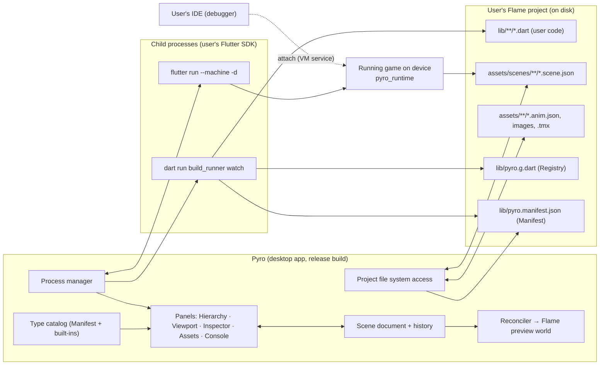
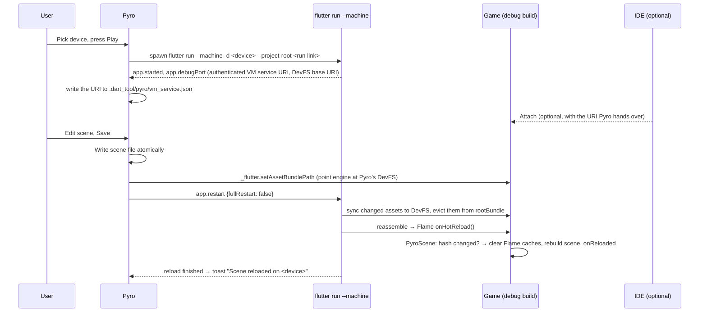

# Pyro — Project Plan

| | |
|---|---|
| **Status** | Reviewed draft (v2) |
| **Date** | 2026-10-16 |
| **Author** | Salah Ahmed |
| **Companion docs** | [`decisions.md`](decisions.md) (decision log, Q1–Q86) · [`../GLOSSARY.md`](../GLOSSARY.md) (project vocabulary) · [`adr/`](adr/) (architecture decision records) · [`claude-design-prompts.md`](claude-design-prompts.md) (UI design prompts) · [`ui-components-plan.md`](ui-components-plan.md) (design-system widgets) · [`phases.md`](phases.md) (phases and progress to v0.1) |

> **For reviewers.** Everything in sections 1–13 was decided in two structured design sessions;
> the decision number (e.g. *Q17*) points to the entry in `decisions.md`. Q1–Q42 come from the
> original design session, Q43–Q73 from the plan review, Q74–Q86 from the spikes and later reviews. Items marked **⚠ verify** are assumptions
> the v0.0 spike must confirm. Items marked **◇ proposed** are details not explicitly decided yet:
> review these hardest. Section 15 lists what is still open. Terms in **bold capitals** (Node,
> Behavior, Override, …) are defined in `GLOSSARY.md`.

---

## Contents

1. [Summary](#1-summary)
2. [Goals and non-goals](#2-goals-and-non-goals)
3. [Users and the core workflow](#3-users-and-the-core-workflow)
4. [Architecture](#4-architecture)
5. [Repository and packages](#5-repository-and-packages)
6. [User-facing API](#6-user-facing-api)
7. [Data formats](#7-data-formats)
8. [Editor internals](#8-editor-internals)
9. [Process orchestration](#9-process-orchestration)
10. [Asset pipeline](#10-asset-pipeline)
11. [Code/data drift and error handling](#11-codedata-drift-and-error-handling)
12. [Platforms, packaging and distribution](#12-platforms-packaging-and-distribution)
13. [Testing and CI](#13-testing-and-ci)
14. [Milestones and work breakdown](#14-milestones-and-work-breakdown)
15. [Risks, open questions and items to verify](#15-risks-open-questions-and-items-to-verify)
16. [Glossary](#16-glossary)

---

## 1. Summary

Pyro is an **open-source desktop editor for games made with the [Flame](https://flame-engine.org)
engine** (Flutter). It gives Flame developers what Unity and Godot users take for granted: a scene
editor where you compose levels visually, attach behaviors, tweak their fields in an inspector,
and press Play to run the game on a real device — while all game **logic stays in plain Dart**,
written in the developer's own IDE.

Key architectural choices:

- **Standalone app** (*Q7*). Pyro never runs user code inside itself. It edits *data* (scene
  files) and runs the user's game as a child process via the user's own Flutter SDK.
- **Pyro runs the game; the IDE attaches** (*Q43*, [ADR 0001](adr/0001-studio-runs-the-game-ide-attaches.md)).
  As in Unity, Play lives in Pyro. Developers attach their IDE's debugger to the running game
  for breakpoints and code hot reload.
- **Data-driven scenes** (*Q3*). Scenes are JSON files loaded at runtime by a small package,
  `pyro_runtime`, through a non-invasive API.
- **Code generation instead of reflection** (*Q12, Q38*). A `source_gen` builder,
  `pyro_generator`, reads annotated user classes and emits (a) the **Registry** used by the
  game to create scene objects and (b) the **Manifest** Pyro reads to build its inspector.
- **Behaviors-first scripting** (*Q6, Q13*) on top of `flame_behaviors`.

It is built solo, on evenings and weekends (*Q5*), MIT-licensed (*Q11*), macOS-first (*Q4*).

---

## 2. Goals and non-goals

### Goals

1. **Compose in the GUI, logic in Dart, see it live on a device.** This loop is the product.
2. Work with **any existing Flame project** without restructuring it (*Q29, Q30*).
3. **Never destroy user data**: scene files survive code renames, deletions and Pyro upgrades
   (*Q32, Q35*).
4. Be **maintainable by one person**: narrow version support, few moving parts, strong tests on the
   core (*Q18, Q33*).
5. Be **contributor-friendly**: a normal Flutter desktop app, documented architecture (*Q37*).

### Non-goals (for v1)

| Not doing | Why / instead |
|---|---|
| Code editor, IDE features | VS Code / Android Studio already do this well; they attach to the running game (*Q2, Q43*) |
| Visual scripting | Logic is Dart (*Q2*) |
| Tilemap editing | Use Tiled; Pyro *places* Tiled maps as Nodes (*Q10*) |
| Pixel/image drawing | Use Aseprite etc.; Pyro slices and imports (*Q8*) |
| Running user code inside the editor | Isolation and plugin compatibility (*Q7, Q16*); the v0.4 Live bridge covers the need |
| Forge2D physics editing | Built-in Flame hitboxes first (*Q9*) |
| Docking/tabbed panel framework | Fixed resizable panels (*Q20*) |
| Web as a Play target | Hidden in v0.1; best effort from v0.3 (*Q70*). Games can still be built for web outside Pyro |
| 3D | Flame is 2D |

---

## 3. Users and the core workflow

**Primary user:** a Dart/Flutter developer making a 2D game with Flame, comfortable with code,
frustrated by placing objects with hard-coded coordinates and restarting the game to tweak values.

### The core loop (v0.1)

1. Open Pyro → pick a Flame project from the project list.
2. First time only: **"Add Pyro to this project"** adds the runtime and generator
   dependencies (and `build_runner ≥ 2.14`), an `assets/scenes/` folder and its
   `pubspec.yaml` asset entry, shows the diff, runs `pub get` (*Q29, Q48, Q53*).
3. Pyro starts `build_runner watch` in the background, or uses one the user already runs
   (*Q48*). The user's annotated behaviors and components appear in the "Add Behavior" list (*Q38*).
4. Create a scene; drag images in from the asset browser; arrange entities with gizmos; add
   hitboxes; attach behaviors and set their fields in the inspector.
5. In their IDE, the user writes `@PyroBehavior() class Patrol extends Behavior<...>` with
   `@Editable() double speed = 50;` → saves → seconds later `speed` is editable in the inspector.
6. In game code: `world.add(await PyroScene.load('assets/scenes/level1.scene.json', registry: pyroRegistry))` (*Q30*).
7. Pick a device in the toolbar (iOS simulator, Android emulator, macOS, a phone; emulators boot on
   demand) → **Play** (*Q17, Q41, Q62*).
8. Optionally **Attach** the IDE debugger to the running game (*Q60*). Saving Dart code hot-reloads
   the game whether or not the IDE is attached (*Q61*).
9. While the game runs, edit the scene and save → the scene **hot-swaps** on the device in about
   a second (*Q66*).

---

## 4. Architecture

### 4.1 Process and component view



### 4.2 Components and responsibilities

| Component | Where it runs | Responsibility |
|---|---|---|
| **Pyro app** (`pyro`) | User's desktop, release build | Project list, editing, preview rendering, running the game, orchestrating child processes. Never imports user code. |
| **Scene document** | Pyro | Immutable model of the open scene; single source of truth (*Q21*). |
| **Reconciler** | Pyro | Turns document changes into minimal changes to a Flame `World` used as the viewport (*Q24*). |
| **Type catalog** | Pyro | Built from the Manifest plus hand-written descriptors for built-in Node kinds; drives inspector field editors and the "Add Behavior/Component" lists (*Q12, Q52*). |
| **Process manager** | Pyro | Spawns and supervises `build_runner watch` and `flutter run --machine`; parses their output into the Console; triggers hot reloads (*Q29, Q61*). |
| **`pyro_annotations`** | User project (via the runtime) and generator | Pure-Dart annotations, no dependencies (*Q44*). |
| **`pyro_generator`** | User project, dev dependency | `source_gen` builder: emits the Registry and the Manifest (*Q38*). |
| **`pyro_runtime`** | Shipped inside the user's game | Scene loader, migrations, lookup API, debug-only Hot-swap through Flame's `onHotReload` (*Q30, Q66*). Re-exports the annotations. |
| **`pyro_ui`** | Pyro, as a library | The design system in Flutter: tokens, theme and presentational widgets. Knows nothing about scenes or app state (*Q83*). |

### 4.3 Why this shape (short rationale for reviewers)

- **Isolation:** user code can't crash or hang the editor; editor bugs and user bugs stay separate.
- **Compatibility:** the user's project never has to build for desktop, so mobile-only plugins (ads,
  some analytics SDKs) don't block Pyro.
- **Performance:** Pyro is an AOT release build (smooth UI), unlike an editor compiled into
  the user's project, which would have to run in debug/JIT mode for hot reload.
- **Pyro owns Play, IDE attaches** ([ADR 0001](adr/0001-studio-runs-the-game-ide-attaches.md)):
  Pyro controls the whole loop (device, Play/Stop, Console, Hot-swap) regardless of the
  developer's IDE; developers keep breakpoints by attaching.
- **No reflection in Flutter:** `dart:mirrors` is unavailable, and `reflectable` was evaluated and
  rejected (generic-type limits, per-entry-point generation, runtime cost in shipped games).
  Full rationale: `decisions.md` Q12, Q38.
- **Cost accepted:** custom components with bespoke rendering appear as placeholders in the
  editor; Play is always a separate process. The v0.4 Live bridge reduces both.

---

## 5. Repository and packages

One repository, **Dart pub workspaces** (*Q28*).

```
pyro/                      ← repo root (this folder)
├─ pubspec.yaml                    ← workspace root
├─ GLOSSARY.md
├─ docs/
│  ├─ project-plan.md              ← this document
│  ├─ decisions.md
│  ├─ adr/
│  ├─ claude-design-prompts.md
│  └─ ARCHITECTURE.md              ← written from v0.0 findings + this plan
├─ packages/
│  ├─ pyro_annotations/    ← pub.dev; pure Dart, no dependencies
│  ├─ pyro_runtime/        ← pub.dev; shipped in games
│  │  ├─ lib/src/scene/            ← model, JSON (de)serialization, migrations
│  │  ├─ lib/src/animation/        ← .anim.json reader
│  │  ├─ lib/src/assets/           ← AssetSource
│  │  └─ lib/src/loader/           ← PyroScene.load, Registry interface, Hot-swap (debug only)
│  ├─ pyro_generator/      ← pub.dev; dev dependency
│  │  ├─ lib/builder.dart
│  │  └─ lib/src/{introspect,registry_emitter,manifest_emitter}.dart
│  └─ pyro_ui/             ← not published; Pyro's design system (Q83)
│     ├─ design/tokens.json        ← copy of the Claude Design tokens; a test checks the Dart side
│     ├─ design/*.html             ← exported view designs (reference for agents; no test reads them)
│     └─ lib/src/                  ← tokens, PrTheme, widgets (buttons, fields, rows, menus…)
├─ apps/
│  └─ pyro/                ← the desktop app (released as binaries, not on pub)
│     ├─ lib/app/                  ← shell, project list, settings
│     ├─ lib/document/             ← document model, transactions, history
│     ├─ lib/viewport/             ← preview world, reconciler, gizmos
│     ├─ lib/panels/               ← hierarchy, inspector, assets, console (built from pyro_ui)
│     ├─ lib/project/              ← SDK detection, setup flow, pubspec sync, version checks
│     └─ lib/process/              ← build_runner + flutter daemon clients, attach support
└─ example/                        ← sample Flame game built with Pyro
```

**Shared code:** the scene model, JSON format and migrations live in `pyro_runtime` and are
imported by Pyro, so Pyro and games can never disagree on the format. When node-level
Hot-swap arrives (v0.4), the scene diff also lives here so Pyro's reconciler and the
Runtime share it (*Q67*).

**Dependency rules**
- `pyro_annotations` is **pure Dart with no dependencies** (*Q44*), like
  `freezed_annotation` or `json_annotation`. Builders run on the plain Dart VM and must never pull
  in Flutter.
- `pyro_runtime` depends on the annotations (re-exported), `flame ≥ 1.36` (for
  `onHotReload`, *Q66*), `flame_behaviors` and Flutter. Keep it small: it ships in every game.
- `pyro_generator` depends on the annotations, `source_gen`, `build` and `analyzer`, and
  matches annotations with `TypeChecker.fromUrl`. It **never** depends on the runtime.
- `pyro_ui` depends on **Flutter only** (plus the Lucide icon font,
  `lucide_icons_flutter`; Inter and JetBrains Mono are bundled), never on
  `flame`, the runtime or the app. Its widgets take plain values and callbacks; nothing in it knows
  about scenes, the document or Riverpod (*Q83*). Only the app depends on it.
- The app depends on the runtime (format, built-in rendering), `pyro_ui`, `flame`,
  `flame_tiled`, Riverpod, freezed. It **never** depends on the generator.

---

## 6. User-facing API

All names are **◇ proposed**; the shape is decided.

### 6.1 Annotations (in `pyro_annotations`)

```dart
@PyroBehavior(
  label: 'Patrol',                 // optional display name
  category: 'Movement',            // groups the Add Behavior list
  // id: 'enemy.patrol',           // optional explicit Type ID (default: class name)
)
class Patrol extends Behavior<PositionedEntity> {
  @Editable(min: 0, max: 400, tooltip: 'Pixels per second')
  double speed = 50;

  @Editable()
  Vector2 direction = Vector2(1, 0); // non-const default → shown as "default from code"

  @Editable()
  PatrolMode mode = PatrolMode.pingPong; // enum → dropdown

  @Editable()
  Player? target;                  // Component subtype → entity reference picker

  @Editable()
  SpriteAnimation? hitEffect;      // asset reference, loaded by the Runtime

  @override
  void update(double dt) { /* user logic */ }
}

@PyroComponent(preview: 'assets/images/boss_preview.png') // drawn in the editor instead of a placeholder
class Boss extends PositionedEntity { ... }
```

**Generator rules** (enforced at build time with clear errors):
- Annotated classes must be public, non-abstract, with an **unnamed constructor callable with no
  arguments**.
- **Type IDs must be unique** across the package: the class name, or the explicit `id:`. Two
  annotated classes with the same Type ID fail the build, naming both (*Q45*,
  [ADR 0002](adr/0002-type-ids-are-class-names.md)).
- `@PyroComponent` classes must extend **`PositionComponent`** in v1. They accept Behaviors only
  if they mix in `EntityMixin`; the generator records this (*Q50*).
- `@Editable` fields must be public, non-final instance fields (never getters or setters, *Q103*)
  of a supported Field type: `int`, `double`, `bool`, `String`, enums, `Vector2`, `Color`, asset
  types (`Sprite`, `SpriteAnimation`, `ImagePath` from `pyro_annotations`, *Q101*), or a
  `Component` subtype that isn't a Behavior (entity reference) (*Q12*). Entity references,
  `Sprite` and `SpriteAnimation` must be nullable (*Q102*); any other non-nullable field needs an
  initializer. Fields inherited from superclasses and mixins count.
- `min`/`max` apply to `int` and `double` only; `min` above `max` is an error, a default outside
  the range a warning (*Q106*). An `@Editable` field no annotated class uses is a warning (*Q104*).
- A Behavior's parent type must be a class; a package using the generator must depend on
  `pyro_runtime`; a field type must be reachable through the declaring file's own imports.
- Unsupported types (e.g. `Map`, `List` in v1) fail the build with a message pointing at the field.
- The Manifest records each type's **supertypes** (so reference fields accept subclasses, *Q57*)
  and each Behavior's **required parent type** (`Behavior<Enemy>`), so the inspector only offers
  Behaviors compatible with the selected Node.

### 6.2 Runtime API (in games)

```dart
import 'package:pyro_runtime/pyro_runtime.dart';
import 'pyro.g.dart'; // generated Registry

class MyGame extends FlameGame {
  late Player player;

  @override
  Future<void> onLoad() async {
    final scene = await PyroScene.load(
      'assets/scenes/level1.scene.json',
      registry: pyroRegistry,              // generated
      // onUnknownType: UnknownType.skip,    // default: throw (Q58)
      onReloaded: _lookUpNodes,              // re-run lookups after a Hot-swap (Q71)
      // assets: AssetSource.bundle(),       // default: the game's bundle, one per Scene
    );
    world.add(scene);
    _lookUpNodes(scene);
  }

  void _lookUpNodes(PyroScene scene) {
    player = scene.find<Player>('player');          // by Node name; throws if ambiguous
    final enemies = scene.findAll(tag: 'enemy');    // by tag
    final boss = scene.find<Boss>('arena/boss');    // by path when names repeat
  }
}
```

- **Non-invasive:** no base class, works in any `FlameGame` (*Q30*).
- **Node names are not unique.** `find` throws if more than one Node matches and points to
  `findAll` or a path (`'enemies/goblin_1'`). The hierarchy panel warns about duplicate sibling
  names (*Q51*). A path is Node names joined by `/`: a Node and its nearest ancestors, at any
  depth, or from the root's children with a leading `/`. `findAll` filters by name or path,
  tag and component type. Lookups work as soon as `load` returns, before the Scene is mounted.
- **Errors** are one `SceneLoadException` naming the Scene and, where they apply, the Node, Type
  ID, field and asset path. A load fails on an Override that doesn't fit its field, a missing
  reference target, a missing asset (*Q114*), a Behavior on a Node that can't hold it
  (`RegistryType.acceptsParent`, *Q112*) and a hitbox directly under the root (*Q115*). An
  Override for a field no code has is ignored with a debug warning.
- **Unknown Type IDs** (class deleted, `id:` changed): `load` **throws** naming the scene, Node and
  Type ID; `onUnknownType: skip` keeps the game running without that Node and everything under it,
  or without that Behavior (*Q58, Q113*).
- **Loading order:** construct all Nodes → assign Overrides and load asset fields → resolve entity
  references (second pass) → add to the tree, so `onLoad` sees configured fields. A failed load
  leaves nothing behind ([`specs/004-runtime/`](../specs/004-runtime/spec.md)).
- **Debug-only Hot-swap** (*Q66, Q67, Q72*): `PyroScene` overrides Flame's `onHotReload()`
  (Flame ≥ 1.36, debug builds only). On each hot reload it re-reads its scene file and every
  `.anim.json` (and, from v0.2, prefab) it uses, and compares the text with what it loaded
  (*Q111*). If nothing changed (e.g. a Dart-only reload), it does nothing. If something changed,
  it **rebuilds the whole scene** into the same `PyroScene` and calls `onReloaded`, once the new
  Nodes are in place and before their own `onLoad`s run. A file that no longer loads leaves the
  old Scene running with a debug error. Images aren't compared or reloaded (*Q72*). Runtime state
  of the scene's Nodes is lost; node-level patching comes in v0.4.
- **Stale references** (*Q71*, provisional "for now"): after a rebuild, references the game kept
  point at removed components. `onReloaded` is the documented way to re-run lookups, and in debug
  builds the Runtime logs a warning the first time a removed Node from the last scene version is
  moved or added back to a tree (*Q110*).
- **Running without Pyro** (*Q64*): games launched from the IDE, CI or release builds load
  scenes normally. In debug, an IDE hot restart picks up saved scene changes; there is no Pyro
  Console. Nothing in the Runtime depends on Pyro.
- **Typed accessors** (`Level1Scene.player`) are a later addition (v0.4).

---

## 7. Data formats

### 7.1 Scene file (`*.scene.json`) (*Q14, Q15, Q27, Q47*)

Pretty-printed in one **canonical form** (*Q92*): `schemaVersion`, `rootId` and `nodes` first, every
other key sorted, one Node per block; paths are Flutter asset keys (project-root relative). The
full contract, including every Field type's written form, is
[`specs/001-scene-format/contracts/scene-file-v1.md`](../specs/001-scene-format/contracts/scene-file-v1.md).

```json
{
  "schemaVersion": 1,
  "rootId": "0b5e",
  "nodes": {
    "0b5e": {
      "childIds": [
        "3f1c",
        "9b2e"
      ],
      "kind": "root"
    },
    "3f1c": {
      "behaviors": [
        {
          "fields": {
            "mode": "pingPong",
            "speed": 80,
            "target": {
              "ref": "9b2e"
            }
          },
          "type": "Patrol"
        }
      ],
      "childIds": [
        "a71d",
        "d220"
      ],
      "kind": "entity",
      "name": "goblin_1",
      "tags": [
        "enemy"
      ],
      "transform": {
        "anchor": "center",
        "angle": 0,
        "position": [320, 128],
        "scale": [1, 1],
        "size": [32, 32]
      }
    },
    "9b2e": {
      "fields": {
        "maxHealth": 5,
        "tint": "#FFFF8800"
      },
      "kind": "custom",
      "name": "player",
      "transform": {
        "anchor": "center",
        "angle": 0,
        "position": [64, 128],
        "scale": [1, 1],
        "size": [32, 48]
      },
      "type": "Player"
    },
    "a71d": {
      "kind": "rectangleHitbox",
      "name": "body",
      "props": {
        "anchor": "topLeft",
        "angle": 0,
        "collisionType": "active",
        "isSolid": false,
        "position": [4, 2],
        "size": [24, 30]
      }
    },
    "d220": {
      "kind": "sprite",
      "name": "sprite",
      "props": {
        "image": "assets/images/goblin_sheet.png",
        "srcPosition": [0, 0],
        "srcSize": [32, 32]
      },
      "transform": {
        "anchor": "topLeft",
        "angle": 0,
        "position": [0, 0],
        "scale": [1, 1],
        "size": [32, 32]
      }
    }
  }
}
```

- **Only Overrides are stored** (*Q46*, [ADR 0003](adr/0003-scenes-store-only-overrides.md)). A
  value the developer explicitly set is stored even if it equals the code default; fields with no
  Override take their default from code, so changing a default in code affects every Node without
  an Override.
- **Only ordered `childIds` are persisted** (*Q47*). The root is an ordinary Node; `parentId` is
  derived on load. The loader repairs or flags inconsistencies (orphans, a Node listed under two
  parents) instead of trusting duplicated facts after a git merge.
- **Type IDs** are class names or explicit `id:`s (*Q45*), so moving a Dart file never breaks a
  scene.
- **Custom components** are `"kind": "custom"` plus `"type"` (*Q50*).
- **Built-in Node properties are written in full** (*Q89*): `transform` on entities, sprites and
  Custom components; `props` on sprites (`image`, optional `srcPosition`/`srcSize`) and hitboxes.
- **Override values** use one written form per Field type (*Q91*): colours as `"#AARRGGBB"`,
  asset references as `{"asset": path}`, a `SpriteAnimation` as `{"asset": path, "animation":
  name}` (spec 004, FR-034), entity references as `{"ref": Node ID}`.
- **Damaged trees are repaired on read** and reported (*Q93*); a new Node kind, Field type or
  required key bumps `schemaVersion` (*Q90*).
- **Entity references** point only to Nodes in the same scene and not inside a Prefab instance in
  v1 (*Q56*).
- Prefab instances (`kind: prefabInstance`, v0.2, arriving with a `schemaVersion` bump per *Q90*)
  carry an `overrides` map from the start, so per-instance overrides (v0.4) need no further format
  change (*Q15*).

### 7.2 Animation file (`*.anim.json`) (*Q8, Q27, Q54*)

**One file per spritesheet**, holding several named animations; it matches Aseprite's export and
keeps the image path in one place.

```json
{
  "schemaVersion": 1,
  "image": "assets/images/goblin_sheet.png",
  "grid": { "cellSize": [32, 32], "offset": [0, 0], "spacing": [0, 0] },
  "animations": {
    "walk": { "frames": [4, 5, 6, 7], "stepTime": 0.1, "loop": true },
    "idle": { "frames": [0, 1], "stepTimes": [0.4, 0.2], "loop": true }
  }
}
```

The format is fixed now; the grid slicer that writes it ships in v0.1.1 (*Q65*).

### 7.3 Manifest (generator → Pyro) (*Q38, Q68, Q76*)

```json
{
  "manifestVersion": 1,
  "types": [
    {
      "id": "Patrol",
      "role": "behavior",
      "label": "Patrol",
      "category": "Movement",
      "parentType": "PositionedEntity",
      "supertypes": ["Behavior"],
      "source": "lib/behaviors/patrol.dart",
      "doc": "Walks between two points.",
      "fields": [
        { "name": "speed", "type": "double", "default": 50, "min": 0, "max": 400, "tooltip": "Pixels per second" },
        { "name": "direction", "type": "vector2", "default": null, "defaultSource": "Vector2(1, 0)" },
        { "name": "mode", "type": "enum", "values": ["pingPong", "loop"], "default": "pingPong" },
        { "name": "target", "type": "entityRef", "refType": "Player" }
      ]
    },
    {
      "id": "Player",
      "role": "component",
      "acceptsBehaviors": true,
      "supertypes": ["PositionedEntity", "PositionComponent", "Component"],
      "fields": []
    }
  ],
  "errors": []
}
```

- Constant defaults are evaluated; non-constant defaults keep their source text for display.
- Generator errors and warnings are written into `errors` and `warnings` too, each with a stable
  `code`, file, line, class and field, so Pyro can show them inline even when the Dart build fails.
  Keys are sorted; the full format is
  [`specs/003-generator/contracts/manifest-v1.md`](../specs/003-generator/contracts/manifest-v1.md).
  `manifestVersion` goes up only for a change an older reader would misread (*Q105*).
- **No timestamps or other non-deterministic content:** the file is committed and checked in CI
  (below), so it must be byte-identical for identical input.
- **Location (*Q68*):** `lib/pyro.manifest.json`, next to the Registry
  `lib/pyro.g.dart`. Both are `build_to: source` outputs of one `$lib$` aggregator that
  reads per-library results from the build cache. Both builders auto-apply to dependents, so a
  game needs no `build.yaml` (*Q107*). **Both are committed**: a fresh clone compiles and opens in Pyro with no build
  step, so a Missing behavior always means the code really changed.
- **CI check (*Q76*).** Getting Started recommends one of two checks, depending on the project's
  Flutter version. Flutter ≤ 3.46 pins `meta` tightly enough that build_runner resolves to at
  most 2.15.1, which has no `--only-check` (spike #2):

  | Project's Flutter | CI step |
  |---|---|
  | ≥ 3.47 (build_runner ≥ 2.16) | `dart run build_runner build --only-check` |
  | ≤ 3.46 | `dart run build_runner build`, then `git diff --exit-code lib/pyro.g.dart lib/pyro.manifest.json` |

  The `git diff` variant wasn't run in spike #2; the contract job (§13) exercises it first.
  Either command takes build_runner's lock, so running one locally stops Pyro's watcher
  (§9.2).
- The per-library builder uses build_runner's `triggers` / `run_only_if_triggered` so files
  without Pyro annotations cost nearly nothing.

### 7.4 Versioning, migrations and compatibility (*Q35, Q49*)

- Every file carries `schemaVersion`. The Runtime holds a chain of pure migration functions
  `v1→v2→v3…`. Loading upgrades in memory; Pyro writes the newest version on save and shows
  an info banner the first time.
- **Guarantee:** any file saved by any earlier release loads in every later release. Files from a
  *newer* Pyro are refused with a clear message (no downgrade support).
- Each migration ships with a fixture test (old file in, expected new file out).
- **Pyro ↔ Runtime compatibility (*Q49*):** Pyro reads the resolved
  `pyro_runtime` version from the project's `pubspec.lock` and checks it against a
  compatibility range built into Pyro. Too old → *Upgrade runtime* (same diff + `pub get`
  flow as setup). Too new → ask the user to update Pyro. Pyro **never writes a
  `schemaVersion` the project's Runtime can't read**.

---

## 8. Editor internals

### 8.1 Document model (*Q21, Q23*)

- `SceneDocument` = immutable, **flat normalized map** `NodeId → Node` over the Runtime's own Node
  classes, plus a parent index `NodeId → parent` beside it (only ordered `childIds` is persisted,
  *Q47*). Built with **freezed**, compared by **identity**: an edit that changes nothing returns
  the same object, so "not identical" means "changed".
- Structural sharing comes from `fast_immutable_collections`' `IMap`: an edit keeps every
  untouched Node as the same object, which the reconciler and `select` rely on.
- Four tree-safe edits (add, remove with its subtree, move, replace) are the only way to a new
  state; `replaceNode` refuses changed children.
- Selection, camera, panel sizes and hover live **outside** the document (*Q25*).
- Built in [`specs/002-document-model/`](../specs/002-document-model/spec.md) (`apps/editor/lib/document/`).

### 8.2 Transactions and history (*Q22*)

```dart
doc.transact('Move 3 nodes', (d) => d.moveNodes(ids, delta), coalesceKey: gestureId);
```

- Every mutation goes through a named transaction; **no other way to change the document**.
- History = list of document snapshots with labels. Undo/redo = move the pointer. Correct by
  construction (no hand-written reverts).
- **Coalescing:** transactions with the same `coalesceKey` in a row (a drag, a slider scrub,
  typing in one field) merge into one history entry with the first one's label; any other
  transaction, an undo, a redo or a save ends the run.
- History keeps 200 steps; memory stays under 2 MB for 200 one-Node steps on 1,000 Nodes
  (*Q99*).
- The **dirty flag** = current snapshot ≠ last saved snapshot, by identity. A Scene repaired on
  open, or restored from a recovery copy, has no saved snapshot until it is saved (*Q96*).
- **Recovery file only** (*Q55*): Pyro writes a recovery copy every 30 s while a Scene with a
  file path has unsaved changes (a Settings value from Phase 7, *Q85*), in its application
  support folder and never in the project, pruned after 30 days (*Q97*); after a crash, the next
  launch offers *Restore*. It never writes the real scene file without the user saving, because
  the running game would hot-swap half-finished edits. Undo history is not persisted across
  sessions.
- Scene files are written **atomically** (temp file, flush, rename) so a hot reload never syncs
  a half-written file.
- A save is refused if the file changed on disk since it was opened or saved (content digest);
  the editor can force it (*Q95*). It is also refused while the Runtime's readable
  `schemaVersion` is unknown or too old (*Q49, Q98*).

### 8.3 Viewport and reconciler (*Q16, Q24*)

- The viewport is a `FlameGame` embedded in Pyro, **not ticking user logic** (no user code
  exists in Pyro).
- Each document change runs the reconciler: walk old vs new document by `NodeId`; Nodes that are
  the *same object* (`identical`) are skipped; changed Nodes patch their preview component;
  added/removed Nodes create/remove components.
- Preview components: built-in Node kinds (sprite, hitboxes; animated sprite from v0.1.1; Tiled
  map from v0.2) render for real using Pyro's Flame; Custom components render as
  **placeholders** (box + Type ID, or the `preview:` image) (*Q6*).
- Gizmos, grid, selection outlines and hover labels are an overlay layer above the preview world.
- **Reference rectangle (*Q85*):** an optional, labelled rectangle for a target resolution
  (e.g. 1280×720) helps place content. Pyro can't read the game's camera (it never runs
  user code), so the size is a per-project setting kept in Pyro's settings, never in the
  project.

### 8.4 Inspector

- Field editors per Field type, generated from the Type catalog.
- **Overridden fields are marked**, with *Reset to default* (removes the Override) (*Q46*).
- Reference fields offer only Nodes whose type is the field's type or a subtype (Manifest
  `supertypes`; built-in Node kinds declare theirs by hand) (*Q57*), in the same scene and not
  inside a Prefab instance (*Q56*).
- Multi-select editing with "mixed" values ships in v0.1.1 (*Q65*).

### 8.5 State management (*Q26*)

**Riverpod** (new to the author — budgeted as learning time in §14). ◇ proposed provider layout:

| Provider | Holds |
|---|---|
| `projectProvider` | open project, SDK info, setup status, Runtime compatibility |
| `documentProvider(sceneId)` | `SceneDocument` + history; exposes `transact` |
| `selectionProvider` | selected `NodeId`s |
| `typeCatalogProvider` | Type catalog: parsed Manifest + built-in descriptors |
| `processProvider` | generator / game process state, attach info and log stream |
| `nodeProvider(id)` | derived: one Node, rebuilds only that tree row / inspector |

### 8.6 UI layout (*Q20, Q83, Q84*)

Fixed resizable panels: Hierarchy (left), Viewport (centre), Inspector (right), Assets/Console
(bottom tabs), toolbar and status bar. Visual design comes from Claude Design using
`claude-design-prompts.md`, then re-implemented in Flutter in `pyro_ui` (*Q83*): the
tokens and theme, the design system's 29 components and the EditorShell layout, built ahead of
the panels against a gallery app (`packages/pyro_ui/example`) and specified in
[`ui-components-plan.md`](ui-components-plan.md) (*Q84*). The panels themselves stay in the app
and compose those widgets. Context menus, dropdown lists and split-button menus are built on
Flutter's `RawMenuAnchor`, tooltips on `RawTooltip` (*Q84*); no menu package.

---

## 9. Process orchestration

### 9.1 SDK detection (*Q39*)

Order: per-project fvm config (`.fvmrc` / `.fvm/`) → `FLUTTER_ROOT` → `flutter` on `PATH` →
manual override in Settings. Pyro shows the detected version in the project list and blocks
Play/setup if none is found. Pyro bundles no SDK.

### 9.2 Code generator (*Q48, Q77*)

- Setup requires **`build_runner ≥ 2.14`**, which has a process lock held for the whole run of
  **any** build_runner command. When another one starts (a second `watch`, a one-off `build`,
  `--only-check`, or `build_runner stop`), the running watcher finishes its build, prints
  `Exiting as requested by another build_runner process.` and exits with code 0.
- Before starting its own watcher, Pyro **probes the lock**
  (`.dart_tool/build/lock/build_runner.lock`, non-blocking exclusive lock, released straight away;
  it never creates the `.requested` file). If it is held, Pyro watches the Manifest file and
  shows **"External build_runner"**.
- Otherwise it runs `dart run build_runner watch` in the project, streams output to the Console,
  and watches the Manifest file.
- **Takeover (*Q77*).** If its watcher exits with that message, Pyro re-probes the lock
  instead of reporting an error:

  | Lock after the exit | What the user ran | Pyro |
  |---|---|---|
  | Held | `build_runner watch`, or a one-off `build` / `--only-check` | Shows "External build_runner"; when the lock is released, starts its own watcher again |
  | Free | `build_runner stop` | Shows "Generator stopped" with a *Start* button; doesn't restart |

  The probe takes 1–4 ms and doesn't disturb a running watcher (spike #2).
- Manifest changes → re-parse → Type catalog, inspector and Add lists update; Missing behavior /
  Missing component states re-evaluate.
- Status bar shows: up to date / generating / error / external / stopped.

### 9.3 Play and Hot-swap (*Q17, Q41, Q43, Q66, Q74, Q81*)



- **Mechanism:** a hot reload issued through `flutter run` syncs changed asset files and clears
  them from `rootBundle` *before* reassemble; Flame ≥ 1.36 then calls `onHotReload()` on mounted
  components. No custom service extension is needed (*Q66*). A reload sent straight over the VM
  service would skip the asset sync, so Pyro always reloads through the daemon.
  Verified in spike #1 on the iOS simulator, an Android emulator and a physical Android phone
  (scene reload 60–250 ms); a Dart-only reload leaves the scene alone.
- **Built in the vertical slice (spec 005, *Q117–Q122*):** the daemon client in the app's
  `process/` feature (`PlayClient`, `PlaySession`) and its command-line entry point
  `apps/editor/bin/play.dart`. It runs `flutter run --machine -d macos --debug` and watches
  `assets/scenes/` from the spawn. Settled saves become one `app.restart` at a time (150 ms
  quiet, at most one queued). It stops with `app.stop`, then SIGTERM, then SIGKILL. It drops
  every VM service address and masks auth codes in all output. The run link, the asset
  re-point, the build_runner watcher, auto code reload and the Console come with #11's rest.
- **Built in Phase 5 (spec 007, *Q125–Q138*):** the editor window's Play and Stop, the Console
  (generator, game and Pyro lines, auth codes masked on entry), the run link and the asset
  re-point before every Scene reload (with the spike's fallback), the Hot-swap failure rule and
  *Restart game*, `GeneratorSupervisor` with the lock probe and External build_runner, code
  reload once the generator is idle, the "Image changed" notice, *Attach debugger* (copies the
  address, opens the VS Code and Android Studio guides) and the stop-before-quit question. **Not
  built, on purpose:** the info file `.dart_tool/pyro/vm_service.json` and the opt-in
  `.vscode/launch.json` above, since Play writes nothing in the project (FR-030); the address
  goes to the clipboard only. They stay in Phase 7 with the device list. The "toggle in
  settings" for code reload also waits for Settings (Phase 7).
- **Code changes (*Q61*):** Pyro watches `lib/` and hot-reloads automatically, waiting until
  `build_runner` reports idle so it never reloads a half-written `.g.dart`. Toggle in settings, on
  by default. If an attached IDE also reloads, the duplicate reload is harmless (the content check
  stops a scene rebuild).
- **Image changes (*Q72*):** images are not part of the hash. When an image the running game uses
  changes on disk, Pyro shows "Image changed: *Restart game*", which does a hot restart
  (`fullRestart: true`). Image Hot-swap comes with the Live bridge.
- **Attach (*Q60, Q81*):** VM service authentication stays on. Each run's URI
  (`ws://127.0.0.1:<port>/<auth code>=/ws`, from `app.debugPort`) is different, so instead of
  making it stable Pyro hands the current one to the debugger.
  - The **Attach debugger** button copies the current run's URI, with short guides for VS Code
    ("Flutter: Attach to Process", paste the URI) and Android Studio. The VS Code guide says to
    select the game's device in the status bar first: the adapter runs `flutter attach`, which
    still needs a device and stops with "More than one device connected" otherwise.
  - On every `app.debugPort`, Pyro writes `{"uri": "<URI>"}` to
    `.dart_tool/pyro/vm_service.json` in the project (atomic write, owner-only
    permissions; `.dart_tool/` is already gitignored) and deletes it when the game stops. The
    Dart and Flutter debug adapters wait for a `vmServiceInfoFile` to appear and read `uri` from
    it, so a file left over from an earlier run would send the IDE to a dead URI.
  - An opt-in **"Add VS Code attach config"** writes `.vscode/launch.json` only after showing the
    diff: an attach entry with
    `"vmServiceInfoFile": "${workspaceFolder}/.dart_tool/pyro/vm_service.json"`. It holds
    no URI, so it is safe to commit and never needs updating, and it can be started before Play
    (the adapter waits for the file). It is the one change to the user's project beyond setup,
    and only on explicit approval. Verified end to end in VS Code (Dart-Code 3.144.0, flutter
    3.44.2, macOS), started both before and after Play, with auth codes on
    ([`ARCHITECTURE.md`](ARCHITECTURE.md#spike-1--play-hot-swap-and-attach) finding 5).
  - No fixed DDS port: flutter picks a free one on each run.
  - **The URI stays out of logs.** It grants full control of the game process. The Console shows
    "Debugger available" instead of it and strips the auth code from any line that carries one
    (on desktop the engine prints its VM service URI to stdout, which reaches the Console as a raw
    line). Pyro's own logs, crash reports and settings never contain it; the info file is
    the only place it is written.
  - **Unauthenticated mode** (escape hatch for a tool that only takes a fixed address): a
    per-project setting, *Allow unauthenticated debugger connections (development only)*, off by
    default and kept in Pyro's settings, never the project. It adds
    `--disable-service-auth-codes` and a fixed `--dds-port`, so the address is the same every run.
    It is offered only for devices running on this machine (desktop, iOS simulator, Android
    emulator): on a physical device the flag also turns authentication off in the VM on the
    device, and on a wirelessly connected iOS device that VM listens on all network interfaces.
    Pyro also checks that the reported URI's host is a loopback address and stops the run
    with an explanation if not. While such a run is active, the toolbar shows an
    "Unauthenticated" warning. The URI is still kept out of logs.
- **Devices (*Q62, Q70*):** the dropdown lists running devices plus available emulators and
  simulators (`flutter devices --machine`, `flutter emulators`); choosing one that isn't booted
  launches it first. Desktop devices appear only if the project has that target (no prompt to add
  one). **Web devices are hidden** in v0.1. Devices reported with `isConnected: false` (paired
  but unreachable phones, which `flutter run --machine` also announces mid-run) are ignored.
  Last choice remembered per project.
- **Lifetime (*Q63*):** one Pyro window per project, at most one running game per project.
  Quitting Pyro or closing the project stops the game (with a confirmation). If the game
  exits any other way (IDE stop, crash, window closed), Pyro notices from `flutter run`'s
  output, shows "Game stopped" in the Console and re-enables Play.
- **Stop** = `app.stop`, then kill the process if it doesn't exit.
- "Play" uses the real `main.dart`; Hot-swap only applies to scenes the game has loaded through
  `PyroScene`.
- **With an IDE attached (*Q74*).** Spike #1 confirmed Pyro's `flutter run` and an
  attached IDE (VS Code, `flutter attach`) can both hot-reload the same game, and IDE
  breakpoints work. It also found that each flutter_tools client keeps its **own DevFS**, which
  breaks Hot-swap in two ways unless Pyro works around it:
  1. **Name clash.** The DevFS is named after the project folder. The attaching IDE finds that
     name taken and deletes Pyro's DevFS. On physical devices (files written through the
     VM service, by name) Pyro's DevFS never comes back: asset re-points fail and the
     Pyro's hot restart fails (`Could not prepare isolate`). **Fix:** Pyro runs with the
     hidden `--project-root` pointing at a symlink to the project with a different folder name,
     `<app support>/run/<project-id>/<name>-pyro`, so the two DevFS names differ.
  2. **Asset shadowing.** Each client points the engine at its own DevFS asset folder once
     (`_flutter.setAssetBundlePath`). After the IDE's first reload, the game reads scenes from the
     IDE's copy, which only changes when the IDE reloads, so Pyro saves are ignored. **Fix:**
     before every reload, Pyro calls `_flutter.setAssetBundlePath` itself with
     `<DevFS base>/build/flutter_assets`. If that fails (folder not created yet), it reloads,
     re-points, evicts the saved scene files (`ext.flutter.evict`) and reloads once more.

  With both, every save rebuilt the scene and every no-op reload left it alone, on macOS,
  the iOS simulator and a physical Android phone, with the IDE reloading and hot-restarting in
  between. Remaining caveats:
  - Both are **private interfaces** (a hidden flutter_tools option and an engine
    `_`-extension). Re-check them on every Flutter stable release (manual end-to-end test in
    §13). If either breaks, use the fallback: while an IDE is attached, Pyro stops issuing
    reloads and asks the user to reload from the IDE.
  - After any hot restart, VS Code may show a stale **"paused"** state with nonsense frames. The
    new isolate starts paused for the IDE (`pause_isolates_on_start` plus DDS resume
    permission); VS Code resumes it, but its UI doesn't clear. The game runs normally. The Attach
    guide should mention it.
  - On Windows (v0.3), the run link needs a directory junction or Developer Mode symlinks. ◇
    proposed

### 9.4 Console

Merged, filterable log of generator output, game output (`app.log`, `daemon.logMessage`, and raw
stdout lines, which is how desktop targets report the game's `print` output) and
Pyro events, with clickable `file:line` links that open the user's external editor
(configurable: VS Code, IntelliJ/Android Studio, custom command). VM service URIs are redacted
before display (§9.3, *Q81*).

---

## 10. Asset pipeline

- **Editor loads from disk** through an `AssetSource` interface (disk implementation in Pyro,
  bundle implementation in games), so newly imported files appear instantly (*Q31*). As built
  (spec 004): two methods, `loadText` and `loadImage`, keyed by project-relative path with no
  prefix; `AssetSource.bundle()` reads the game's bundle with its own image cache and never
  touches Flame's globals. Verified in
  spike #3: the disk side is an `AssetBundle` over the project folder plus a Pyro-owned image
  cache that frees an old image only after it's off screen; each Node records the files it read,
  and a file change rebuilds just those Nodes, ~75–200 ms from save to screen (*Q79*).
- **Scenes live in `assets/scenes/` by default** (*Q53*). Pyro finds scenes by looking for
  `*.scene.json` under the declared asset folders; there is no config file.
- **`pubspec.yaml` sync (*Q31, Q53*):** Flutter asset folder entries **don't include subfolders**,
  so whenever Pyro imports an asset or saves a scene into a folder that isn't declared yet
  (including `assets/scenes/prefabs/`), it appends that folder. It never reorders or reformats;
  the first time it shows a diff. Editing YAML while preserving formatting needs a careful
  approach (e.g. `yaml_edit`). ◇ proposed
- **Undeclared folders (*Q85*):** the asset browser marks a folder that holds assets but isn't
  declared in `pubspec.yaml` with "Not in pubspec.yaml", because the game can't load from it.
  Pyro doesn't fix it on its own; importing or saving into the folder declares it as above.
- **References by path**, with renames/moves done in Pyro rewriting all references across
  scenes and animations, and a confirmation listing what changes (*Q27*). Ships in v0.1.1 (*Q65*).
- **Grid slicer** (v0.1.1) writes `.anim.json`. **Aseprite import** (v0.2) reads Aseprite's JSON
  export (frames + tags → animations). TexturePacker atlases later (*Q8*).
- **Tiled maps** (v0.2): a `tiledMap` Node kind referencing a `.tmx`, rendered in the viewport via
  `flame_tiled` from disk; entities placed on top (*Q10*). Maps load through the Runtime's own
  loader, which resolves tileset and image paths as Tiled does, in both Pyro and the game
  (*Q78*); verified in spike #3.

---

## 11. Code/data drift and error handling

| Situation | Behavior |
|---|---|
| Behavior/component class no longer exists | **Pyro:** Node/Behavior kept verbatim; inspector shows **"Missing behavior: Patrol"** / **"Missing component"** with preserved values (read-only), actions *Remove* / *Keep* (*Q32*). **Runtime:** `load` throws naming scene, Node and Type ID, unless `onUnknownType: skip` (*Q58*) |
| Two annotated classes share a Type ID | Build fails, naming both classes; fix with an explicit `id:` (*Q45*) |
| Class renamed | Keep its old name as an explicit `id:` and the scene is unaffected (*Q45*) |
| Dart file moved | No effect: Type IDs don't include the library path (*Q45*) |
| Field removed | Value kept in the file as orphaned; shown under "Unused values" with *Remove* |
| Field type changed trivially (`int`→`double`, `String`↔enum when value valid) | Converted with a warning |
| Code default changed | Applies to every Node without an Override (*Q46*) |
| Asset missing | Inline error with *Locate…*; scene still opens |
| Entity reference target deleted | Field shows "missing reference"; deleting a referenced Node warns first ◇ proposed |
| Scene file changed on disk while open | Banner: *Reload* / *Keep mine* |
| Scene from a newer Pyro | Refused, with the required version |
| Project's Runtime older/newer than Pyro supports | *Upgrade runtime* / *Update Pyro*; never write an unreadable `schemaVersion` (*Q49*) |
| Generator fails | Last good Manifest stays in use; status bar + Console show the error |
| Image changed while the game runs | Toast: *Restart game* (*Q72*) |
| Game crashes / build fails / stopped from the IDE | Console shows "Game stopped" with exit code, *Run again* (*Q63*) |

**Principle:** Pyro never silently deletes or rewrites user data it doesn't understand.

---

## 12. Platforms, packaging and distribution

- **Pyro platforms (*Q4*):** macOS first-class for v0.1; Windows and Linux built in CI (best
  effort) until first-class in v0.3. The user's *game* can target any platform Flutter supports;
  **Play** supports mobile and desktop devices, with web hidden until v0.3 or later (*Q70*).
- **macOS app:** not sandboxed (it spawns processes and reads arbitrary project folders), hardened
  runtime, **Developer ID signed and notarized** — requires an Apple Developer account
  ($99/year) (*Q40*).
- **Distribution:** GitHub Releases (`.dmg`; later `.msix`/`.zip`, AppImage) for the developer
  preview and v0.1; **auto-update** (Sparkle / WinSparkle) in v0.2; Homebrew cask / winget in v0.3
  (*Q40*).
- **Third-party licences:** Pyro's About window opens Flutter's licence page
  (`showLicensePage`). It lists every pub dependency's `LICENSE` on its own; the fonts bundled in
  `pyro_ui` (Inter, JetBrains Mono, SIL OFL 1.1) are not packages, so their
  `fonts/*-OFL.txt` become package assets and the app registers them with
  `LicenseRegistry.addLicense` at startup. Part of work item 1.
- **Packages** `pyro_annotations`, `pyro_runtime` and `pyro_generator` on
  pub.dev. **Name check with the Flame maintainers before the first `pub publish`** — pub names
  can't be released (*Q36, Q44*).
- **Version policy (*Q18*):** the Runtime supports the latest stable Flame minor (then current +
  previous after Pyro 1.0), with a floor of **Flame 1.36** for `onHotReload` (*Q66*); Flutter
  stable only; **`build_runner ≥ 2.14`** (*Q48*). The scene format never depends on a Flame
  version. When Flame 2.0 ships, the Runtime and Pyro's bundled Flame move to it
  together in one release, and the 1.x line gets fixes only (*Q80*).

---

## 13. Testing and CI

| Layer | Tests | Weight |
|---|---|---|
| Document & history | transactions, coalescing, undo/redo, dirty tracking | Heavy |
| Serialization & migrations | round-trip every Node kind; one fixture per migration; `childIds`-only repair cases | Heavy |
| Reconciler | document diff → expected component ops | Heavy |
| Generator | golden tests: annotated source → Registry + Manifest; error cases (Type ID collision, unsupported field, bad constructor) | Heavy |
| Runtime loader | load fixture scenes into a `FlameGame` with `flame_test`; reference resolution; asset loading; unknown Type ID; Hot-swap hash check | Heavy |
| **Contract (*Q59*)** | CI runs the generator on `example/`, checks the Manifest against its golden file, then loads every `example/` scene with `flame_test` against the real generated Registry | Heavy |
| Process clients | daemon protocol parsing with recorded transcripts (`apps/editor/test/fixtures/daemon/`, no real Flutter); build_runner lock probe | Medium |
| Design system (`pyro_ui`, *Q84*) | widget tests per component state; one golden per gallery grid (macOS CI only) | Medium |
| Panels | a few widget tests for critical interactions | Light |
| End-to-end | `example/` game smoke test on a device before each release, incl. Play, Hot-swap, Attach (manual in v0.1) | Manual |

**CI (GitHub Actions):** analyze + test on macOS, Windows, Linux; contract job; build Pyro on
all three; on tags, sign + notarize the macOS build and attach artifacts to a GitHub Release
(*Q33*).

---

## 14. Milestones and work breakdown

**Capacity assumption:** ~3 evenings/week of ~3 hours. Estimates are in evenings and are
deliberately rough. Solo evening projects typically overrun by 1.3–1.5×; the totals below do not
include that. [`phases.md`](phases.md) groups this section's build order into phases and tracks
progress; change it in the same commit as this section.

### v0.0 — De-risking spike (throwaway) (*Q42, Q69*)

| # | Check | Pass criterion | Est. |
|---|---|---|---|
| 1 | Play, Hot-swap and Attach | (a) Pyro-style `flutter run --machine` → edit a scene → `app.restart` → `PyroScene.onHotReload` rebuilds it, on the iOS simulator, the Android emulator **and one physical phone**. (b) A Dart-only hot reload does **not** rebuild the scene. (c) **VS Code attaches** via a fixed DDS port: breakpoints hit, and IDE hot reload works while Pyro's `flutter run` is still connected. | 2 |
| 2 | Generator shape and latency | `$lib$` aggregator writes Registry + Manifest to `lib/`; `build_runner watch` updates them within ~3 s on a mid-size project; lock probe detects an external watcher | 1 |
| 3 | Disk rendering | Pyro renders a sprite, an animation and a Tiled map loaded from an arbitrary folder | 0.5 |
| | Write findings into `ARCHITECTURE.md` | | 0.5 |
| | **Total** | | **~4** |

Spike 1(c) is the deciding test for [ADR 0001](adr/0001-studio-runs-the-game-ide-attaches.md).
**Spike #1 is done:** all three checks pass with two workarounds (*Q74*), and the fallback (the
Pyro stops issuing reloads while an IDE is attached) remains the escape hatch. Findings in
[`ARCHITECTURE.md`](ARCHITECTURE.md#spike-1--play-hot-swap-and-attach); code in
`spikes/01_play_hotswap/`.

### Early preview — first external feedback (*Q82*)

The goal is to prove, in a developer's own project, that Pyro does a real task more easily
than editing Dart by hand, as early as possible. **Breadth and polish are cut; document integrity,
the generator/Runtime contract and data preservation are not.** The final v0.1 scope is unchanged
(*Q82* amends *Q65* and supersedes *Q73*); the early preview is a subset of it, ~48 of the ~93.5
evenings.

**The task testers do:** open their own Flame project, place an entity with a sprite and a hitbox,
attach a custom Behavior and tweak its fields, press Play and see the change in the running game.

| # | Work item (v0.1 numbering) | In the early preview | Deferred to v0.1 | Est. |
|---|---|---|---|---|
| 0 | Repo setup | As in v0.1 | | 3 |
| 1 | App shell | Project list, open project, basic SDK detection, Runtime compatibility check; the editor window: EditorShell with panel slots, scene tabs, new/open/save scene, dirty marker, close confirmation, recovery *Restore* prompt (*Q88*) | "Add Pyro" flow and pubspec diff (a README recipe replaces it), SDK management and settings polish | 3 |
| 2 | Document model | Transactions, undo/redo with coalescing, atomic save/load, recovery file, `schemaVersion` gate (never write an unreadable version, *Q49*) | Migrations framework, built when the first format change after the preview needs it | 4.5 |
| 3 | Hierarchy | Add, delete, rename, reparent by drag (on `PrTreeRow`) | Duplicate, filter, duplicate-name warning | 2 |
| 4 | Viewport | Preview world, reconciler, pan/zoom, selection, move gizmo | Grid, snapping, rotate/scale gizmos (numeric editing in the inspector covers them) | 6.5 |
| 5 | Inspector | Transform; editors for `int`, `double`, `bool`, `String`, enum, `Vector2` and an asset-path dropdown; Override markers + *Reset to default* (on `PrPropertyRow`, `PrNumberProperty`, `PrVector2Property`). Other Field types (`Color`, entity reference, `Sprite`, `SpriteAnimation`) show **read-only and round-trip untouched** | Remaining Field type editors, multi-select "mixed" values (v0.1.1) | 2.5 |
| 6 | Built-in Node kinds | Entity, sprite, rectangle and circle hitboxes, placeholders | The remaining hitbox kind | 2 |
| 7 | Generator | Introspection, Type IDs + collisions, supertypes, Registry + Manifest emitters, error reporting, goldens, for every v1 Field type (*Q100*) | Nothing; the inspector's editors for the remaining Field types are item 5's | 6.5 |
| 8 | Runtime | Full: loader, two-pass references, assets, lookup API, unknown-type handling, Hot-swap (*Q116*) | | 5 |
| 9 | Behaviors in the inspector | Add/remove, compatibility filtering, Missing behavior state (so nothing is lost) | Reorder, Missing behavior polish | 2 |
| 11 | Play (built in Phase 5, [`specs/007-play`](../specs/007-play/spec.md); the dry run is open) | Run on the macOS desktop target by default (Hot-swap there verified in the vertical slice, ~0.5, *Q88*), daemon client, Console, Hot-swap trigger, auto code reload, build_runner lock/external mode, *Attach debugger* copying the current URI, image-restart toast | Device list + emulator boot, Attach info file, `launch.json`, unauthenticated mode | 4 |
| 12 | CI contract test | As in v0.1, turned on in the vertical slice (*Q88*) | | 1 |
| 13 | `example/` game | A skeleton for the vertical slice and the contract test: one annotated Behavior, one custom component, one Scene, macOS target (*Q88*) | The small sample game | 0.5 |
| 14 | Design system (core, *Q84, Q87*) | Foundations (interaction states, field box, panel focus, icons, gallery skeleton, test config) and the widgets whose behaviour items 3 and 5 would otherwise build in the panels: `PrTreeRow`, `PrPropertyRow`, `PrNumberProperty`, `PrVector2Property` | The other 25 components, the EditorShell, goldens (all since built ahead of the preview, which uses them throughout, *Q87*) | 5.5 |
| | **Total** | | | **~48** |

Not in the early preview: the asset browser and pubspec sync (10), the `example/` game beyond its
skeleton (13), the rest of the visual design (14; see the row above), signing and notarization (15; testers build from
source) and the Getting Started docs (16; a README recipe covers setup). Setup friction is itself
under test, so watch where testers get stuck.

**Build order:** 0 → 14 (all of it, built ahead, *Q84, Q87*) → 2 → 7 → 8 → **vertical slice**
(the `example/` skeleton from item 13, the contract test (12), and a hand-written Scene JSON
through generator, Runtime, Play and Hot-swap on the macOS desktop target, with no editor UI; the
first slice of item 11) → 1 → 6 → 4 → 3 → 5 → 9 → rest of 11 → *early preview* (*Q88*). The slice
removes the integration risk the three spikes could not, checks Hot-swap on the preview's default
Play target, guards the data contract in CI from then on, and makes the author the first user.
Item 1 comes before the panels because they need a window, an open project and scene files to
work in.

**At 3 evenings a week:** ~16 weeks before overrun, ~5 months with a 1.4× overrun (against ~5
months and ~7 months for the previous developer preview).

**Before building, at no cost:** ask the Flame maintainers about the name (*Q36*), the longest
lead-time item. (A short GIF of the spike #1 loop on the Flame Discord, as a demand check, was
planned here too; it was canceled on 2026-10-18.)

**Testers and exit criteria.** 5–8 hand-picked developers using their own games, a few watched on
a call, not a public Discord post. Record: time from install to the first running scene, where
setup failed, and whether they would use it over editing Dart. Decide the response in advance:

| Observation | Response |
|---|---|
| Several testers fail at setup (pubspec, Flutter/`build_runner` versions, Q76) | Fix setup before any new feature; reconsider the in-app "Add Pyro" flow |
| Testers hit stale references or lost state after Hot-swap (Q-I, *Q71*) | Pull node-level patching forward from v0.4 |
| Testers don't reach for the viewport and edit the inspector or JSON | Re-examine the viewport investment (item 4) before polishing it |
| Testers need Field types or Node kinds that were deferred | Reorder v0.1 by what they asked for |
| Testers complete the task and say it beat editing Dart | Continue to v0.1 as planned |

### v0.1 — First public release (macOS) (*Q34, Q65, Q82*)

| # | Work item | Est. (evenings) |
|---|---|---|
| 0 | Repo setup: workspace (3 packages + app; `pyro_ui` added by *Q83*), CI skeleton, lint rules, Riverpod learning spike | 3 |
| 1 | App shell: project list, SDK detection, editor window (scene tabs, new/open/save, recovery prompt), settings, About window with licences (§12), "Add Pyro" flow + pubspec diff, Runtime compatibility check | 7 |
| 2 | Document model, transactions, history, coalescing, save/load (atomic), recovery file, migrations framework | 5 |
| 3 | Hierarchy panel (add, delete, rename, reparent drag, duplicate, filter, duplicate-name warning) | 3.5 |
| 4 | Viewport: preview world, reconciler, pan/zoom, grid, selection, gizmos, snapping, reference rectangle (*Q85*) | 10 |
| 5 | Inspector: transform + field editors for all v1 Field types, Override markers + *Reset to default* | 4.5 |
| 6 | Built-in Node kinds: entity, sprite, 3 hitbox kinds, placeholders | 2.5 |
| 7 | Generator: introspection, Type IDs + collisions, supertypes, Registry + Manifest emitters, error reporting, goldens | 6.5 |
| 8 | Runtime: loader, two-pass references, asset loading, lookup API, unknown-type handling, Hot-swap (`onHotReload`, content check, `onReloaded`) | 5 |
| 9 | Behaviors in the inspector: add/remove/reorder, compatibility filtering, Missing behavior UI | 3 |
| 10 | Asset browser + pubspec sync (incl. subfolders) | 2.5 |
| 11 | Play: device list + emulator boot, daemon client, Console, Hot-swap trigger, auto code reload, build_runner lock/external mode, Attach (current URI, info file, launch.json, unauthenticated mode), lifecycle, image-restart toast | 9 |
| 12 | CI contract test | 1 |
| 13 | `example/` game | 2 |
| 14 | Design system in `pyro_ui` (*Q83, Q84*): tokens and theme (done), shared foundations, the 29 components, EditorShell, 60 icons, gallery app, widget tests and goldens ([`ui-components-plan.md`](ui-components-plan.md)) | 23 |
| 15 | Signing, notarization, release pipeline, pub.dev publishing of `pyro_annotations`, `pyro_runtime` and `pyro_generator` | 3 |
| 16 | README, Getting Started (incl. Attach and the CI check, §7.3), demo video, `ARCHITECTURE.md` polish | 3 |
| | **Total** | **~93.5** |

**Moved to v0.1.1 (*Q65*):** grid slicer and the animated sprite Node kind (~6), rename with
reference rewriting (~1.5), multi-select "mixed" values (~2).

**Reality check:** ~93.5 evenings at 3/week ≈ **31 weeks (~7 months)** before overrun, ~9 months
with a 1.3× overrun, against the original ~4-month target. Item 14 grew from 4 to ~23 when its
components were estimated one by one (*Q84*); ~2.5 of that can move to v0.1.1 if needed (colour
picker popover, NumberProperty expressions, goldens, SplitButton; `ui-components-plan.md` §8.1).

**Early preview (*Q82*):** the v0.1 table above is the final scope. A subset of it (~48 evenings)
ships first as the early preview described in the section above; the previous full-scope
developer preview (*Q65*, *Q73*) is replaced by it. Feedback from the early preview is folded
into the remaining ~45.5 evenings, so the order of the deferred items is open until then.

Build order after the early preview: 10 → the deferred parts of items 1–9 and 11 → 15 → the
rest of 13 → 14 (final pass against the design; the goldens exist) → 16 (*Q88*). Pyro's UI depends on the Pyro components (`Pr` widgets) for everything,
the early preview included (*Q87*), so there is no switch onto the design system after it.

### Roadmap after v0.1

| Version | Contents |
|---|---|
| **v0.1.1** | Grid slicer → `.anim.json` and the animated sprite Node kind, rename with reference rewriting, multi-select "mixed" values |
| **v0.2** | Aseprite import, prefab instancing (prefabs included in the Hot-swap hash), Tiled map Nodes, auto-update |
| **v0.3** | Windows + Linux first-class, Homebrew / winget, web as a best-effort Play target |
| **v0.4** | Live bridge to the running game (select/tweak live, exact custom rendering), node-level Hot-swap (scene diff shared with the reconciler), image Hot-swap, prefab overrides, typed scene accessors, `@PyroComponent(preview:)` polish |
| **Later** | Forge2D, particle/effects editors, docking panels, light theme |

`@RenamedFrom` is dropped: an explicit `id:` covers renames (*Q45*).

---

## 15. Risks, open questions and items to verify

### 15.1 Risks

| Risk | Likelihood | Impact | Mitigation |
|---|---|---|---|
| Hot-swap with an attached IDE depends on private flutter_tools/engine interfaces (`--project-root`, `_flutter.setAssetBundlePath`) | Medium | High (Attach workflow) | Spike #1 settled the mechanism (*Q74*); re-check on each Flutter stable release; fallback: Pyro stops reloading while an IDE is attached |
| Hot-swap rebuild loses runtime state and leaves stale references in game code | High (by design in v0.1) | Medium | Content-hash check; `onReloaded` + debug warning (*Q71*); node-level patching in v0.4 |
| Scope/time overrun (solo, evenings) | **High** | Medium | Cuts to v0.1.1; early preview (~48 evenings, *Q82, Q84, Q88, Q100, Q116*); strict non-goals; estimates in §14 |
| `build_runner` too slow on large projects | Medium | Medium | Spike #2; `triggers` so unannotated files are skipped; show "generating" state |
| Flame / `flame_behaviors` breaking changes | Medium | Medium | Latest-minor-only policy; CI against Flame stable; Runtime kept small |
| Pyro and project Runtime versions drift | Medium | Medium | `pubspec.lock` compatibility check; never write an unreadable `schemaVersion` (*Q49*) |
| Generic behaviors (`Behavior<Enemy>`) attached to incompatible Nodes | Medium | Low | Parent type + supertypes in the Manifest; filter in inspector; runtime type check with clear error |
| Placeholders make custom-rendered games feel unfinished in the editor | Medium | Medium | `@PyroComponent(preview:)`; Live bridge in v0.4 |
| Name conflict / perceived as official | Low | Medium | Ask Flame maintainers before publishing (*Q36*) |
| macOS signing/notarization friction | Medium | Low | One-time CI setup; Developer ID account budgeted |
| Learning Riverpod while building | Medium | Low | Budgeted spike in item 0; keep provider graph small (§8.5) |
| Community uptake | Unknown | High (for an OSS goal) | Early Discord contact, early preview with hand-picked testers (*Q82*), demo video, works with existing projects |

### 15.2 Open questions

The plan review settled Q-A (→ *Q65*), Q-B (→ *Q54*), Q-C (→ *Q45*), Q-D (→ *Q68*), Q-E (→ *Q55*),
Q-F (→ *Q56*) and Q-G (→ *Q50*), and Q-H, the preview scope (→ *Q73*, since superseded by *Q82*). Still open:

- **Q-I — Stale references after Hot-swap.** *Q71* (`onReloaded` + debug warning) was accepted
  "for now". Revisit after the early preview, where testers are asked about it directly (§14),
  possibly by pulling node-level patching forward from v0.4.

### 15.3 Items to verify in v0.0

1. ✅ Play → Hot-swap through `app.restart` and `onHotReload` on simulator, emulator and a
   physical phone; Dart-only reloads don't rebuild scenes; an IDE attached via a fixed DDS port
   can hot-reload alongside Pyro. Done in spike #1, with the workarounds in §9.3 (*Q74;
   Q75 since superseded by Q81*); findings in [`ARCHITECTURE.md`](ARCHITECTURE.md#spike-1--play-hot-swap-and-attach).
2. ✅ `$lib$` aggregator output to `lib/`, watch latency, and the build_runner lock probe (§7.3,
   §9.2). Done in spike #2 (~0.9–1.0 s per save on 300- and 1000-file projects; *Q76, Q77*);
   findings in [`ARCHITECTURE.md`](ARCHITECTURE.md#spike-2--generator-shape-and-latency).
3. ✅ `flame_tiled` and image loading from an arbitrary on-disk folder inside Pyro (§10).
   Done in spike #3 (*Q78, Q79*); findings in
   [`ARCHITECTURE.md`](ARCHITECTURE.md#spike-3--disk-rendering).

---

## 16. Glossary

Project vocabulary lives in [`GLOSSARY.md`](../GLOSSARY.md) at the repo root: Pyro, Runtime,
Generator, Scene, Node, Node kind, Entity, Behavior, Custom component, Prefab, Prefab instance,
Node name, Type ID, Type role, Editable field, Field type, Override, Registry, Manifest, Type
catalog, Missing behavior / Missing component, Document, Play, Attach, Hot-swap, Live bridge.
