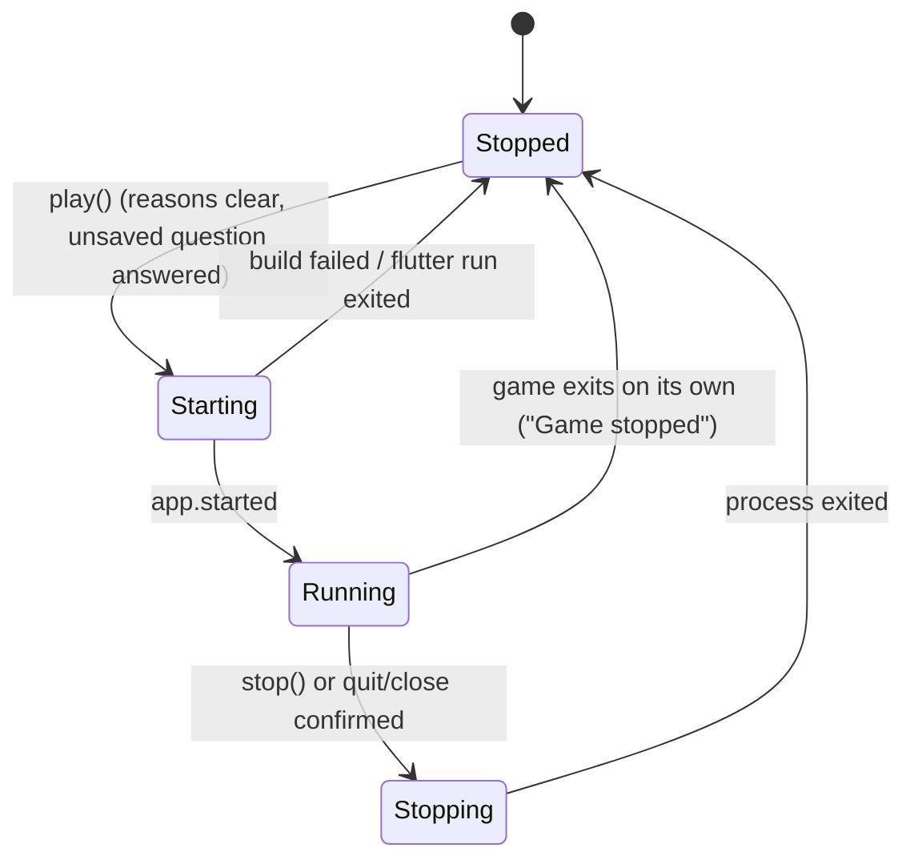
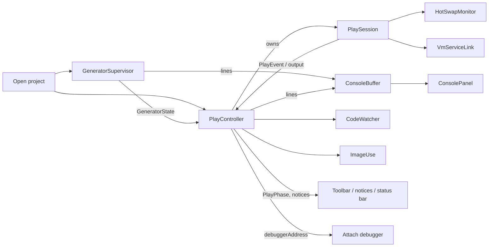

# Data Model: Play (Phase 5)

Nothing here is persisted. A Play session, the generator state and the Console exist in memory for
as long as the project is open. The only thing written outside memory is the run link, in Pyro's
application-support folder. Types are Dart and live in `apps/editor/lib/process/src/` unless
noted. Names follow `GLOSSARY.md`.

## Play

### `PlayPhase` (what the toolbar shows)

The spec's four states. The existing `PlayState` of a session (`starting`, `running`, `reloading`,
`stopping`, `stopped`) maps onto them; `reloading` shows as Running.

| From | Event | To | Also |
|---|---|---|---|
| Stopped | `play()` | Starting | creates the run link; spawns `flutter run`; starts the scene, code and image watchers |
| Starting | `app.started` | Running | applies a Scene save made while starting (spec 005) |
| Starting | exit before `app.started` | Stopped | Console shows the compiler output; never shows Running (FR-016) |
| Running | `stop()` | Stopping | `app.stop`, then SIGTERM, then SIGKILL (existing) |
| Running | exit not requested | Stopped | "Game stopped" in the Console and a notice (FR-014) |
| Stopping | exit | Stopped | removes the run link; clears the address; cancels watchers |
| Starting / Running / Stopping | `play()` | unchanged | does nothing (FR-002) |

### `PlayBlock` (why Play is disabled, FR-003)

A value with `reason` (plain language) and `fix` (the single action). Checked in this order; the
first that applies is shown:

| Order | Reason | Fix shown |
|---|---|---|
| 1 | The project failed to open | the project's own error |
| 2 | No Flutter SDK detected | how SDK detection looks (`.fvmrc`, `FLUTTER_ROOT`, `PATH`) |
| 3 | The Runtime is incompatible or missing | the compatibility check's message |
| 4 | No `macos/` folder | `flutter create --platforms=macos .` (run it in the project) |

`null` means Play is available.

### `PlaySession` additions (existing class, spec 005)

| Member | Type | Rule |
|---|---|---|
| `debuggerAddress` | `String?` | In memory only; set on the first `app.debugPort`; null after the session ends; documented as for *Attach debugger* only; never in an event, a `toString`, an exception or a log (R3) |
| `restart()` | `Future<void>` | `app.restart {fullRestart: true}`; used by *Restart game*; not re-pointed |
| reload path | internal | scene Hot-swaps run R5's re-point sequence first; code-only reloads do not |
| `PlayHotSwapFailed` | event | emitted by the monitor's state; carries the paths and the count, never an address |

### `HotSwapMonitor` state (per session)

| Field | Meaning |
|---|---|
| `baseline: Map<String, String>` | project-relative Scene path → SHA-256 of its content at the last report (or at session start) |
| `armed: Set<String>` | paths the game announced with a `loaded` or `reloaded` line |
| `expected: Map<String, Deadline>` | paths whose content changed and still wait for a report (3 s after the reload finished) |
| `misses: int` | consecutive saves that got no report; 0 after any report |
| `failed: bool` | set at `misses == 2`; cleared by *Restart game* |

Transitions: a batch whose file hash differs from `baseline` and whose path is `armed` adds an
expectation; a report line removes it and sets `misses = 0`; a missed deadline adds 1; at 2,
`failed = true` and Hot-swaps stop (code reloads continue).

## Generator

### `GeneratorState`

| State | Meaning | Status bar text |
|---|---|---|
| `notSetUp` | the project has no `build_runner` dependency, its resolved `build_runner` is older than 2.14, or the Runtime check failed; nothing runs; carries a `reason` (for an old version, the version found and `2.14`) | "Generator: not set up" |
| `starting` | spawning, before the first build line | "Generator: starting" |
| `generating` | a build is running | "Generating…" |
| `upToDate` | the last build succeeded | "Up to date" |
| `error` | the last build failed; carries `file`, `message` | "Generator error" (click for details) |
| `external` | a generator Pyro did not start holds the lock | "External build_runner" |
| `stopped` | the user ran `build_runner stop`; carries nothing | "Generator stopped" with a *Start* button |

Transitions and the takeover table are in [contracts/generator-supervisor.md](contracts/generator-supervisor.md).
The state also carries `ownedByPyro: bool` (false only in `external`) and a monotonically
increasing `generation` counter that the code watcher uses to see "went idle after my save".

### `LockProbeResult`

`held`, `free`, `absent` (no lock file; never created).

## Console

### `ConsoleLine` (immutable)

| Field | Type | Rule |
|---|---|---|
| `text` | `String` | already redacted; no trailing newline |
| `source` | `ConsoleSource` | `generator`, `game`, `pyro` |
| `severity` | `ConsoleSeverity` | `info`, `warning`, `error`; from the source's own level (daemon `error: true`, a `[SEVERE]` generator line); `info` otherwise |
| `time` | `DateTime` | from `clock`; used for ordering display only |
| `sequence` | `int` | strictly increasing per buffer; the order the lines entered |

`PlayOutputSource` of spec 005 (`game`, `stderr`, `tool`) maps to the Console like this: `game` →
`game`; `stderr` and `tool` → `game` when the line came from the build of the game (compiler output
is part of "the game's" output for the user) and `pyro` for Pyro's own notes.

### `ConsoleBuffer`

| Rule | Value |
|---|---|
| Capacity | 10,000 lines (`PlayDefaults.consoleCapacity`); the oldest line drops first |
| Redaction | `redactAuthCodes` on entry, always (FR-025) |
| Notification | at most once per 50 ms (`PlayDefaults.consoleNotify`) |
| Filter | a set of enabled `ConsoleSource`s; the empty set is never offered, all enabled is the default |
| Clear | empties the buffer; does not touch the sources |

## Image use

`ImageUse` holds `Set<String>` of project-relative image paths named by any Scene in the project, and
a flag `changed` (the set of changed paths since the last restart). A change to a path in the set
raises the notice; a restart clears `changed` and rebuilds the set.

## `PlayDefaults` (constants until Settings, Phase 7)

| Constant | Value | Source |
|---|---|---|
| `sceneQuiet` | 150 ms | spec 005, *Q122* |
| `stopTimeout` | 5 s | spec 005 |
| `hotSwapReportWait` | 3 s | clarification, FR-011 |
| `hotSwapMissLimit` | 2 | clarification, FR-011 |
| `codeReloadSettle` | 2 s | clarification, FR-012 |
| `lockReprobe` | 1 s | R8 |
| `consoleCapacity` | 10,000 | R12 |
| `consoleNotify` | 50 ms | R12 |

## Relationships

`GeneratorState` feeds the status bar and the code watcher; `PlayController` feeds the toolbar and
the notices; the Console receives from all three sources; the address flows only along the last
arrow.
